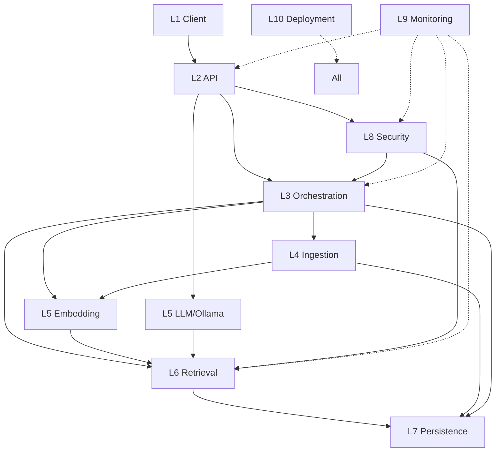

# معماری منطقی POC — شرح تفصیلی لایه‌ها

**نسخهٔ سند**: ۱.۰  
**تاریخ آخرین به‌روزرسانی**: ۱۴۰۵/۰۲/۲۶ (2026-05-26)  
**مبنای طراحی**: مستند طراحی POC زیرساخت هوش مصنوعی سازمانی آفلاین (نسخهٔ ۰.۳)  
**زبان**: فارسی، با حفظ نام‌های فنی انگلیسی  

---

## بخش ۱ — مقدمه

### هدف مستند

این مستند، «معماری منطقی POC — شرح تفصیلی لایه‌ها» عنوان دارد و هدف از آن بسط و شرح هر یک از ده لایهٔ منطقیِ تعریف‌شده در مستند اصلی (نسخهٔ ۰.۳) است، به‌گونه‌ای که تیم توسعه، معماران و ارزیابان فنی بتوانند بدون مراجعه مداوم به مستند اصلی، تصور کاملی از مسئولیت‌ها، ورودی‌ها، خروجی‌ها، قراردادها، حالت‌ها و رفتار خطا هر لایه داشته باشند.

### مخاطب هدف

- **توسعه‌دهندگان بک‌اند**: برای درک مرزهای ماژول‌ها، قراردادهای بین‌لایه‌ای، و lieux کدگذاری
- **معماران سیستم**: برای تأیید تفکیک مسئولیت، وابستگی‌ها، و نقاط تصمیم‌گیری کلیدی
- **ارزیابان فنی و QA**: برای طراحی تست‌های یکپارچگی، سناریوهای End-to-End، و معیارهای پذیرش

### رابطه با مستند اصلی (نسخهٔ ۰.۳)

این مستند **مکمل** مستند اصلی است، نه جایگزین. مستند اصلی (نسخهٔ ۰.۳) حاوی تصمیمات معماری، ارزیابی ابزارها، ماتریس انتخاب، و جزئیات پیاده‌سازی است. این مستند همان محتوای معماری منطقی را می‌گیرد و در قالب یک «شرح تفصیلی لایه‌به‌لایه» با ساختار ۲۲ بخش بازنویسی می‌کند. هر بخش به بخش‌های مربوطه در مستند اصلی ارجاع دارد (مثلاً «طبق بخش ۵ مستند اصلی» یا «طبق جریان داده در بخش ۱۰»).

### توضیح مهم: این مستند «شرح تفصیلی» است، نه «تصمیم معماری جدید»

- هیچ ابزار، فناوری، یا قابلیت جدیدی که در مستند اصلی نیست، اینجا اضافه نشده است.
- هیچ تصمیم معماری جدیدی گرفته نشده است.
- اگر در مستند اصلی سکوت یا ابهام وجود داشته باشد، در بخش «نکات مبهم و نیازمند تأیید» همان لایه ثبت شده و یک «پیشنهاد شفاف‌سازی» کوتاه (نه تصمیم) ارائه شده است.
- تمام ارجاعات به نسخه‌های ابزار، License، و وضعیت تأیید، عیناً از مستند اصلی نقل شده‌اند (همه با برچسب «نیازمند تأیید» marca شده‌اند).

---

## بخش ۲ — نمای کلی معماری منطقی

### نمودار متنی (ASCII) از ده لایه و ارتباطات بین آن‌ها

```
┌─────────────────────────────────────────────────────────────────────────────┐
│                         L1: Client & Access Layer                           │
│                    (Streamlit UI + Auth Session)                            │
│                              │                                              │
│                              ▼                                              │
│                         L2: API & Application Layer                         │
│                    (FastAPI Endpoints: /upload, /query, /documents)         │
│                    ┌─────────────┬─────────────┐                            │
│                    ▼             ▼             ▼                            │
│           L3: Orchestration   L8: Security    L5-Embedding (ST)            │
│           (State Machine)     (AuthN/AuthZ)   (Sentence Transformers)       │
│                    │             │             │                            │
│                    ▼             ▼             ▼                            │
│           L4: Ingestion      L6: Retrieval   L5-LLM (Ollama)              │
│           (Parse/Chunk)      (Search/RRF/     (Local LLM Inference)        │
│                             ACL Reval)                                     │
│                    │             │             │                            │
│                    ▼             ▼             ▼                            │
│         ┌──────────┴─────────────┴─────────────┐                          │
│         │        L7: Data & Persistence        │                          │
│         │  MinIO | PostgreSQL | Qdrant | OS    │                          │
│         └──────────────────────────────────────┘                          │
│                              │                                              │
│                              ▼                                              │
│                         L9: Monitoring & Evaluation                         │
│                    (logging + audit_log + Ragas)                           │
│                              │                                              │
│                              ▼                                              │
│                        L10: Deployment & Offline Ops                        │
│                    (Docker Compose, Offline Transfer)                       │
└─────────────────────────────────────────────────────────────────────────────┘
```

**توضیح**: فلش‌ها جهت جریان کنترل اصلی را نشان می‌دهند. لایه‌های L3، L4، L5 (Embedding)، L6، L8 در پردازش Ingestion و Query درهم‌تنیده می‌شوند. L7 ذخیره‌سازی پایدار برای همه است. L9 و L10 لایه‌های عرضی (Cross-cutting) هستند.

### هر لایه یک «مرز مسئولیت» است، نه لزوماً یک «کانتینر»

مستند اصلی در بخش ۴ (معماری منطقی و لایه‌ها) و بخش ۸ (فهرست نهایی فناوری‌های منتخب) تصریح کرده که POC با **۶ کانتینر** استقرار می‌یابد، در حالی که **۱۰ لایهٔ منطقی** وجود دارد. این به این معنی است که چند لایه منطقی در یک کانتینر فیزیکی ادغام شده‌اند. اصل حاکم: **تفکیک منطقی برای شفافیت معماری، ادغام فیزیکی برای سادگی عملیات**.

### اصل «Modular Monolith» و نگاشت ده لایه به ۶ کانتینر

طبق بخش ۹ مستند اصلی (معماری فیزیکی استقرار)، نگاشت به شرح زیر است:

| کانتینر | لایه‌های منطقی درون آن | دلیل ادغام |
|---|---|---|
| `app` | L1 (Streamlit UI)، L2 (FastAPI)، L3 (Worker Orchestration)، L4 (Ingestion Library)، L5-Embedding (Sentence Transformers)، L6 (Retrieval Logic)، L8 (Auth Library) | Modular Monolith: یک فرایند Python، صفر شبکه بین لایه‌های بالا، سادگی استقرار و اشکال‌زدایی |
| `ollama` | L5-LLM Runtime | سرویس جداگانه LLM inference (مدیریت مدل، API OpenAI-compatible) |
| `qdrant` | L6 (Vector Search Engine) | موتور جستجوی برداری مستقل |
| `opensearch` | L6 (BM25 Lexical Search Engine) | موتور جستجوی لفظی مستقل |
| `minio` | L7 (Object Storage) | ذخیره‌سازی اسناد اصلی و Chunkهای Canonical |
| `postgres` | L7 (Metadata/ACL/State)، L8 (ACL Reference) | دیتابیس متریک، مرجع معتبر ACL و وضعیت |

**نتیجه**: L9 (Monitoring) به‌صورت کتابخانه در کانتینر `app` اجرا می‌شود (logging + audit_log در PG + Ragas به‌صورت اسکریپت آفلاین). L10 (Deployment) ابزاری است روی Host، نه کانتینر.

---

## بخش ۳ — لایهٔ ۱: Client & Access Layer (L1)

### ۱. هدف و مسئولیت اصلی

لایه ۱ واسط کاربری حداقلی POC را فراهم می‌کند: صفحه ورود، فرم آپلود سند (DOCX/XLSX)، رابط پرسش و پاسخ، و نمایش منابع استنادشده. احراز هویت ساده (Session بر اساس Cookie/JWT کوتاه‌مدت) نیز در این لایه gestion می‌شود. **ارجاع**: بخش ۵ لایه ۱ مستند اصلی برای ارزیابی ابزارها و توصیه Streamlit.

### ۲. مرز لایه (چه چیزی داخل، چه چیزی خارج)

| داخل این لایه | خارج از این لایه (و لایهٔ مقصد) |
|---|---|
| رندر UI (Streamlit) | پردازش فایل آپلود شده → L2 API |
| مدیریت Session کاربری (login/logout، `st.session_state`) | اعتبارسنجی توکن/Session → L8 Security |
| ارسال درخواست HTTP به `/upload`، `/query`، `/documents` | اجرای منطق RAG، جستجو، LLM → L2/L6/L5 |
| نمایش پاسخ LLM و فهرست منابع (`document_id`، `location_meta`) | ذخیره‌سازی سند، Chunk، ایندکس → L7 |
| اعتبارسنجی اولیه سمت کلاینت (پسوند فایل، اندازه) | Idempotency، Chunking، Embedding → L3/L4/L5 |

### ۳. ورودی‌های لایه

| نام ورودی | منبع | فرمت | شرط ورود (Validation) |
|---|---|---|---|
| Credentials کاربر | کاربر نهایی (Browser) | `username`/`password` | غیر خالی، کاراکترهای مجاز |
| فایل سند | کاربر نهایی (File Upload) | `.docx` یا `.xlsx` (MIME type) | پسوند مجاز، اندازه ≤ حداکثر تنظیم‌شده (پیشنهاد: ۵۰MB) |
| متن پرسش (Query) | کاربر نهایی (Text Input) | رشته UTF-8 | غیر خالی، طول ≤ ۲۰۰۰ کاراکتر |
| اقدام‌های UI (کلیک، ناوبری) | مرورگر | رویداد Streamlit | — |

### ۴. خروجی‌های لایه

| نام خروجی | مقصد | فرمت | شرط خروج (Success Criteria) |
|---|---|---|---|
| HTTP Request `/upload` | L2 API | `multipart/form-data` | کد ۲۰۰/۲۰۱، برگرداندن `document_id` |
| HTTP Request `/query` | L2 API | JSON `{query: string}` | کد ۲۰۰، برگرداندن `{answer, sources[]}` |
| HTTP Request `/documents` | L2 API | GET | کد ۲۰۰، لیست اسناد مجاز کاربر |
| رویداد Logout | L8 Security | — | Session باطل شده، هدایت به صفحه ورود |

### ۵. ارتباطات منطقی

| لایهٔ طرف مقابل | جهت | نوع ارتباط | قرارداد |
|---|---|---|---|
| L2 API & Application | بالا‌دست (Downstream) | **Sync (HTTP)** | REST endpoints: `POST /upload`، `POST /query`، `GET /documents`؛ Schema: Pydantic models در L2 |
| L8 Security & Identity | عرضی (Cross-cutting) | **Sync (Function Call در FastAPI Dependency)** | اعتبارسنجی Session/Token؛ جدول `users` در PostgreSQL |

**توضیح**: L1 مستقیماً با L3، L4، L5، L6، L7 ارتباط ندارد. تمام درخواست‌ها از لایه API (L2) عبور می‌کنند.

### ۶. ارتباطات فیزیکی

- **کانتینر میزبان**: `app` (همین کانتینر که FastAPI، Worker، و Embedding Runtime را هم میزبان می‌کند)
- **شبکه**: `frontend` (تنها کانتینر در این شبکه). پورت `8501` روی Host منتشر شده.
- **Volume**: `app_models` (اختیاری، برای cache مدل‌های Sentence Transformers در صورت mount مستقیم)

### ۷. حالت‌ها و چرخهٔ حیات

L1 **بی‌حالت (stateless)** از نظر منطق nghiệp است. حالت کاربری (`user_id`، `role`، `session_token`) در `st.session_state` و Cookie/JWT نگهداری می‌شود و اعتبار آن توسط L8 در هر درخواست بررسی می‌شود. Streamlit به‌صورت ذاتی stateful است اما داده‌های nghiệpی در لایه‌های پایین‌تر مدیریت می‌شوند.

### ۸. خطاها و رفتار در شرایط خرابی

| خطا | رفتار مورد انتظار | ارجاع ریسک (بخش ۱۶ مستند اصلی) |
|---|---|---|
| عدم دسترسی به L2 (Network error / 5xx) | نمایش پیام خطای دوستانه در UI؛ عدم کرش برنامه | — |
| Session منقضی/نامعتبر (۴۰۱ از L2) | حذف `session_state`، هدایت به صفحه ورود | L8: Fail Closed |
| آپلود فایل نامعتبر (پسوند/اندازه) | اعتبارسنجی سمت کلاینت پیش از ارسال؛ در صورت عبور، خطای ۴۰۰ از L2 نمایش داده شود | — |
| Timeout درخواست طولانی (Query) | نمایش انیمیشن بارگذاری؛ در صورت timeout، پیام «زمان پاسخ فراتر از انتظار رفت» | L5-LLM: کیفیت پایین فارسی / زمان پاسخ بالا |

### ۹. نکات مبهم و نیازمند تأیید

| ابهام | پیشنهاد شفاف‌سازی |
|---|---|
| مستند اصلی برای Streamlit نسخه «نیازمند تأیید» نوشته؛ نسخه دقیق کدام است؟ | در Phase 1 نسخه پایدار از PyPI رسمی قفل شود (مثلاً `streamlit==1.38.0`). |
| آیا UI باید از RTL و فونت فارسی پشتیبانی کامل کند؟ | Streamlit به‌صورت پیش‌فرض RTL را به‌خوبی مدیریت نمی‌کند. پیشنهاد: برای متن‌های RTL از `st.markdown` با HTML/CSS سفارشی استفاده شود یا در Phase 1 تست شود. |
| مدیریت چندین کاربر هم‌زمان در Streamlit (`st.session_state` جداگانه) چگونه است؟ | Streamlit به‌صورت پیش‌فرض session جداگانه برای هر اتصال Browser دارد. تست هم‌زمانی ۲–۳ کاربر در Phase 1 تأیید شود. |

---

## بخش ۴ — لایهٔ ۲: API & Application Layer (L2)

### ۱. هدف و مسئولیت اصلی

لایه ۲ لایه API برنامه است: endpointهای `POST /upload`، `POST /query`، `GET /documents`، اعتبارسنجی ورودی‌ها با Pydantic، Dependency Injection برای احراز هویت (L8)، و orchestrating فراخوانی لایه‌های Orchestration (L3)، Retrieval (L6)، و LLM (L5). **ارجاع**: بخش ۵ لایه ۲ مستند اصلی برای ارزیابی FastAPI، Flask، Litestar و توصیه FastAPI.

### ۲. مرز لایه (چه چیزی داخل، چه چیزی خارج)

| داخل این لایه | خارج از این لایه (و لایهٔ مقصد) |
|---|---|
| تعریف FastAPI routes و Pydantic schemas | منطق Orchestration (State Machine، Job Queue) → L3 |
| اعتبارسنجی Schema ورودی (Upload/Query) | پارس DOCX/XLSX، Chunking، Normalization → L4 |
| Dependency `get_current_user` برای Auth | تولید Embedding → L5 (Sentence Transformers) |
| فراخوانی Worker Enqueue (INSERT در `processing_jobs`) | جستجوی برداری/لفظی، RRF، ACL Revalidation → L6 |
| مونتاژ Context و فراخوانی Ollama API | ذخیره‌سازی Canonical در MinIO/PG → L7 |
| ثبت `audit_log` در PostgreSQL | مدیریت مدل LLM (pull، serve) → L5 (Ollama Container) |

### ۳. ورودی‌های لایه

| نام ورودی | منبع | فرمت | شرط ورود |
|---|---|---|---|
| `POST /upload` request | L1 (Streamlit) | `multipart/form-data` با فایل | MIME type: `application/vnd.openxmlformats-officedocument.wordprocessingml.document` یا `application/vnd.openxmlformats-officedocument.spreadsheetml.sheet` |
| `POST /query` request | L1 (Streamlit) | JSON `{ "query": "string" }` | `query` غیر خالی، max ۲۰۰۰ char |
| `GET /documents` request | L1 (Streamlit) | Query params (pagination) | Session معتبر |
| Auth Token/Session | L1 (Cookie Header) | JWT یا Signed Cookie | امضای معتبر، انقضای نشده |

### ۴. خروجی‌های لایه

| نام خروجی | مقصد | فرمت | شرط خروج |
|---|---|---|---|
| `POST /upload` response | L1 | JSON `{ "document_id": "ulid", "status": "uploaded" }` | ۲۰۱ Created؛ `document_id` معتبر |
| `POST /query` response | L1 | JSON `{ "answer": "string", "sources": [{ "document_id", "location_meta", "score" }] }` | ۲۰۰ OK؛ منابع غیرخالی اگر نتیجه وجود داشته باشد |
| `GET /documents` response | L1 | JSON array اسناد مجاز | ۲۰۰ OK |
| `INSERT processing_jobs` | L3 (via PG) | ردیف در جدول `processing_jobs` | `status = 'pending'` |
| `audit_log` insert | L9 (via PG) | ردیف در `audit_log` | ثبت موفق |

### ۵. ارتباطات منطقی

| لایهٔ طرف مقابل | جهت | نوع ارتباط | قرارداد |
|---|---|---|---|
| L1 Client | بالا‌دست | Sync (HTTP) | REST + Pydantic Schema |
| L3 Orchestration | پایین‌دست | **Async (via PG Table)** | جدول `processing_jobs` (schema: `job_id`, `document_id`, `stage`, `status`, `attempt_count`, `error_log`) |
| L4 Ingestion | پایین‌دست | **Sync (In-process Function Call)** | توابع Python: `parse_docx()`، `parse_xlsx()`، `chunk()`، `normalize_fa()` |
| L5 Embedding | پایین‌دست | **Sync (In-process Library Call)** | `SentenceTransformer.encode()` → `List[float]` |
| L5 LLM (Ollama) | پایین‌دست | **Sync (HTTP)** | `POST http://ollama:11434/api/generate` با schema OpenAI-compatible |
| L6 Retrieval | پایین‌دست | **Sync (Function Call)** | توابع: `vector_search()`، `bm25_search()`، `rrf_fuse()`، `acl_revalidate()`، `get_canonical_chunks()` |
| L7 Persistence | پایین‌دست | **Sync (SDK/Client)** | MinIO SDK (`put_object`/`get_object`)، PG (SQLAlchemy/psycopg)، Qdrant Client، OpenSearch Client |
| L8 Security | عرضی | **Sync (FastAPI Dependency)** | `get_current_user()` → `User` object؛ جدول `document_acl` برای ACL |

### ۶. ارتباطات فیزیکی

- **کانتینر میزبان**: `app` (همین کانتینر L1، L3، L4، L5-Embedding، L6-Logic، L8)
- **شبکه**: `frontend` (برای پاسخ به L1) و `backend` (برای دسترسی به Qdrant، OpenSearch، MinIO، PostgreSQL، Ollama)
- **Volume**: `app_models` (اختیاری، برای مدل‌های Sentence Transformers)

### ۷. حالت‌ها و چرخهٔ حیات

L2 **بی‌حالت (stateless)** است. تمام حالت در PostgreSQL (جدول `documents`، `processing_jobs`، `document_acl`، `audit_log`) و MinIO/Qdrant/OpenSearch نگهداری می‌شود. هر درخواست HTTP مستقل پردازش می‌شود.

### ۸. خطاها و رفتار در شرایط خرابی

| خطا | رفتار مورد انتظار | ارجاع |
|---|---|---|
| اعتبارسنجی Pydantic ناموفق (۴۲۲) | برگرداندن خطای جزئیات فیلد به L1 | — |
| Auth نامعتبر (۴۰۱) | Fail Closed: پاسخ ۴۰۱، بدون پردازش query | L8 Security |
| Insert در `processing_jobs` ناموفق | Log خطا، پاسخ ۵۰۰ به L1 | L3 Retry/Retry Logic |
| Ollama timeout / ۵xx | ثبت در `audit_log`، پاسخ خطا به L1 (بدون context) | L5-LLM Risk: زمان پاسخ بالا |
| Qdrant/OpenSearch انقطاع | در Ingestion: Job `failed`، Retry. در Query: نتیجه خالی، Fail Closed برای ACL | L6 Retrieval |
| MinIO upload error | Job `failed`، Retry | L7 Persistence |

### ۹. نکات مبهم و نیازمند تأیید

| ابهام | پیشنهاد شفاف‌سازی |
|---|---|
| نسخه دقیق FastAPI قفل نشده («نیازمند تأیید») | در Phase 1 نسخه پایدار (مثلاً `fastapi==0.112.0`) از PyPI رسمی قفل شود. |
| آیا `BackgroundTasks` برای کارهای سبک در L2 استفاده می‌شود یا همه از طریق L3 Worker؟ | مستند اصلی می‌گوید `BackgroundTasks` برای کارهای طولانی مناسب نیست و Worker چرخشی L3 جبران می‌کند. پیشنهاد: فقط کارهای بسیار سبک (مثل ارسال notification) در BackgroundTasks؛ پردازش سند کاملاً در L3. |
| مدیریت خطای هم‌زمانی در Insert `processing_jobs` (race condition) | از Constraint یکتایی `document_id` + `status` در PG استفاده شود یا `SELECT FOR UPDATE` در تراکنش. |

---

## بخش ۵ — لایهٔ ۳: Domain & Orchestration Layer (L3)

### ۱. هدف و مسئولیت اصلی

لایه ۳ مغز هماهنگی POC است: ماشین حالت Document Lifecycle (`uploaded → validated → parsed → chunked → indexed → active/failed`)، تضمین Idempotency (بر اساس SHA-256 فایل)، مکانیزم Retry با `attempt_count`، و کنترل Activation خودکار پس از `index_validation`. **ارجاع**: بخش ۵ لایه ۳ مستند اصلی برای ارزیابی Python+PG Worker، Celery+Redis، APScheduler و توصیه Python+PG Worker.

### ۲. مرز لایه (چه چیزی داخل، چه چیزی خارج)

| داخل این لایه | خارج از این لایه (و لایهٔ مقصد) |
|---|---|
| State Machine اسناد (transitionهای وضعیت) | پارس واقعی سند، Chunking، Normalization → L4 |
| جدول `processing_jobs` و Worker چرخشی (Polling) | تولید Embedding → L5 (Sentence Transformers) |
| Idempotency Check (SHA-256 در `documents.content_hash`) | ایندکس‌گذاری در Qdrant/OpenSearch → L6 |
| Retry Logic (`attempt_count`، threshold ۳) | ذخیره‌سازی Canonical در MinIO/PG → L7 |
| Activation خودکار (بدون گردش‌کار تأیید) | ACL و Security → L8 |
| اسکریپت Reconciliation دستی (برای اصلاح دستی) | UI/API → L1/L2 |

### ۳. ورودی‌های لایه

| نام ورودی | منبع | فرمت | شرط ورود |
|---|---|---|---|
| ردیف `processing_jobs` با `status = 'pending'` | L2 (via INSERT) | سطر جدول PG | `job_id` معتبر، `document_id` موجود در `documents` |
| رویداد Reconciliation (دستی) | Operator / Cron | فراخوانی اسکریپت Python | — |

### ۴. خروجی‌های لایه

| نام خروجی | مقصد | فرمت | شرط خروج |
|---|---|---|---|
| `UPDATE processing_jobs SET status = 'running' ...` | L3 (خود) | تراکنش PG | موفقیتی |
| فراخوانی توابع L4 (Parse/Chunk/Normalize) | L4 | In-process Call | بازگشت داده‌های استخراج‌شده |
| فراخوانی L5 Embedding | L5 | In-process Call | بردارهای embedding |
| فراخوانی L6 Indexing (Qdrant/OpenSearch upsert) | L6 | SDK Call | upsert موفق |
| `UPDATE documents SET status = 'active'` | L7 (PG) | تراکنش PG | پس از `index_validation` موفق |
| `UPDATE processing_jobs SET status = 'completed/failed'` | L3 (خود) | تراکنش PG | پایان چرخه |

### ۵. ارتباطات منطقی

| لایهٔ طرف مقابل | جهت | نوع ارتباط | قرارداد |
|---|---|---|---|
| L2 API | بالا‌دست | Async (PG Table) | جدول `processing_jobs` (Producer: L2، Consumer: L3 Worker) |
| L4 Ingestion | پایین‌دست | Sync (In-process) | توابع Python ماژول `ingestion/` |
| L5 Embedding | پایین‌دست | Sync (In-process) | `SentenceTransformer.encode(texts)` |
| L6 Retrieval/Indexing | پایین‌دست | Sync (SDK) | Qdrant `upsert`، OpenSearch `index` |
| L7 Persistence | پایین‌دست | Sync (SDK/SQL) | MinIO `put_object`، PG `UPDATE` |
| L8 Security | عرضی | Sync (Function) | ACL Check در Activation (اختیاری، بیشتر در Query) |

### ۶. ارتباطات فیزیکی

- **کانتینر میزبان**: `app` (Worker به‌صورت یک اسکریپت/فرایند جداگانه در همین کانتینر، یا Thread/Process جداگانه)
- **شبکه**: `backend` (برای Qdrant، OpenSearch، MinIO، PostgreSQL)
- **Volume**: بدون Volume اختصاصی (داده‌ها در PG/MinIO/Qdrant/OS)

### ۷. حالت‌ها و چرخهٔ حیات (State Machine)

این لایه **حالت‌دار (stateful)** است و ماشین حالت سند را مدیریت می‌کند. نمودار کامل در بخش ۱۷ این مستند ترسیم شده است. خلاصه حالت‌ها:

```
uploaded → validated → parsed → chunked → indexed → active
                    ↓ (failure at any stage)
                  failed
```

**انتقال‌ها**: هر مرحله توسط Worker پردازش می‌شود. در صورت موفقیت، وضعیت `processing_jobs.stage` به‌روزرسانی شده و مرحله بعد در همان Job یا Job جدید (طراحی ساده: یک Job با stage متوالی) صف می‌شود. در صورت شکست، `attempt_count++`؛ اگر `≥ 3` → `failed`.

**Idempotency**: در مرحله `validated`، `content_hash` بررسی می‌شود. اگر موجود باشد، `document_id` موجود برگردانده شده و Job کامل نمی‌شود (Subsequent uploads are no-op).

### ۸. خطاها و رفتار در شرایط خرابی

| خطا | رفتار مورد انتظار | ارجاع |
|---|---|---|
| Parse/Chunk/Normalize Exception | `attempt_count++`، `error_log` پر شود، `status = 'pending'` برای Retry | L4 Risk: پیچیدگی استخراج DOCX |
| Embedding Generation Error | مشابه بالا؛ اگر مدل Embedding بارگذاری نشده باشد، Worker crash نکند | L5 Risk: حجم بالای مدل Embedding |
| Qdrant/OpenSearch Upsert Error | Retry تا ۳ بار؛ در صورت تکرار `failed` | L6 Risk: مصرف RAM OpenSearch |
| Index Validation Mismatch (count mismatch) | `status = 'failed'`، `error_log` با جزئیات تفاوت | — |
| PostgreSQL Deadlock در UPDATE | Retry با backoff در Worker Loop | — |

### ۹. نکات مبهم و نیازمند تأیید

| ابهام | پیشنهاد شفاف‌سازی |
|---|---|
| آیا یک `processing_jobs` ردیف برای کل چرخه است یا هر Stage یک Job جداگانه؟ | مستند اصلی در جریان Ingestion (بخش ۱۰) مراحل ۷ تا ۱۷ را در یک جریان نشان می‌دهد. پیشنهاد: یک Job با فیلد `stage` که مقادیر `parsed`، `chunked`، `indexed` می‌گیرد؛ ساده‌تر برای POC. |
| فاصله چرخش (Polling Interval) Worker چقدر باشد؟ | مستند اصلی: ۲–۵ ثانیه قابل قبول. پیشنهاد: `config.WORKER_POLL_INTERVAL = 3` ثانیه، قابل تنظیم از `.env`. |
| مکانیزم Reconciliation دستی چه پارامترهایی بگیرد؟ | پیشنهاد: اسکریپت `reconcile.py --status failed --retry` که Jobهای `failed` با `attempt_count < 3` را به `pending` بازگرداند. |
| آیا Activation واقعاً «خودکار» است یا نیاز به تایید ادمین دارد؟ | مستند اصلی: «ساده‌سازی به فعال‌سازی خودکار پس از اعتبارسنجی ایندکس». پیشنهاد: کاملاً خودکار در POC؛ در تولیدی می‌تواند Gate اضافه شود. |

---

## بخش ۶ — لایهٔ ۴: Document Ingestion & Processing Layer (L4)

### ۱. هدف و مسئولیت اصلی

لایه ۴ مسئول دریافت فایل‌های DOCX/XLSX، بررسی فرمت، استخراج متن و ساختار (پاراگراف، Heading، جدول)، استخراج داده‌های Excel با حفظ اطلاعات `sheet_name`، `row_range`، `column_range`، نرمال‌سازی فارسی (یکسان‌سازی Yeh/Kaf، ZWNJ، ارقام، حذف Tatweel)، Chunking با استراتژی پاراگراف/بخش جدول، و تولید Canonical Chunks با Metadata کامل است. **ارجاع**: بخش ۵ لایه ۴ مستند اصلی برای ارزیابی python-docx+openpyxl، Docling، Unstructured و توصیه python-docx+openpyxl.

### ۲. مرز لایه (چه چیزی داخل، چه چیزی خارج)

| داخل این لایه | خارج از این لایه (و لایهٔ مقصد) |
|---|---|
| پارس DOCX با `python-docx` (پاراگراف، استایل Heading، جدول) | ذخیره‌سازی فایل اصلی در MinIO → L7 (قبل از L4 در جریان) |
| پارس XLSX با `openpyxl` (sheet/cell/row/col، `data_only=True`) | محاسبه SHA-256 برای Idempotency → L3 (قبل از L4) |
| ماژول نرمال‌سازی فارسی (توابع خالص Python) | تولید Embedding → L5 |
| Chunking: پاراگراف/بخش جدول، overlap ۱۰–۱۵٪، هدف ۵۱۲–۱۰۲۴ توکن | ایندکس‌گذاری در Qdrant/OpenSearch → L6 |
| Chunking هوشمند Excel: جدول کوچک (<۵۰ سطر) = یک Chunk با سرستون؛ جدول بزرگ = Row Groupها با تکرار سرستون در هر Chunk | ثبت Metadata Chunk در PostgreSQL → L7 |
| تولید `chunk_id` (ULID)، `content_hash`، `location_meta` | — |

### ۳. ورودی‌های لایه

| نام ورودی | منبع | فرمت | شرط ورود |
|---|---|---|---|
| محتوای فایل DOCX | L3 Worker (از MinIO یا حافظه) | باینری / `BytesIO` | فایل معتبر DOCX، `python-docx` قابل پارس |
| محتوای فایل XLSX | L3 Worker | باینری / `BytesIO` | فایل معتبر XLSX، `openpyxl` قابل پارس |
| `document_id`، `document_version` | L3 / PG | ULID، Integer | معتبر و موجود در `documents` |
| تنظیمات Chunking | Config / `.env` | Dict: `target_tokens`, `overlap_percent` | مقادیر معتبر (مثلاً ۵۱۲–۱۰۲۴، ۱۰–۱۵٪) |

### ۴. خروجی‌های لایه

| نام خروجی | مقصد | فرمت | شرط خروج |
|---|---|---|---|
| لیست Chunkها | L3 Worker (برای مراحل بعد) | List[Dict] با فیلدهای Chunk Schema | هر Chunk: `chunk_id`، `document_id`، `document_version`، `chunk_index`، `content`، `source_type` (`word_paragraph`/`excel_sheet_row`)، `location_meta`، `content_hash` |
| Metadata برای PG `chunks` table | L7 (PG) | ردیف‌های جدول `chunks` | تعداد برابر با Chunkهای تولیدشده |
| محتوای Chunk برای MinIO | L7 (MinIO) | باینری/متن در `chunks/{document_id}/{chunk_id}.txt` | ذخیره موفق |

### ۵. ارتباطات منطقی

| لایهٔ طرف مقابل | جهت | نوع ارتباط | قرارداد |
|---|---|---|---|
| L3 Orchestration | بالا‌دست | Sync (In-process Function Call) | توابع: `parse_document(file_bytes, doc_type)` → `List[Chunk]` |
| L5 Embedding | پایین‌دست | Sync (In-process) | Chunkها به `SentenceTransformer.encode()` پاس داده می‌شوند |
| L7 Persistence (MinIO/PG) | پایین‌دست | Sync (SDK/SQL) | MinIO `put_object` برای محتوای Chunk؛ PG `INSERT` برای metadata |

### ۶. ارتباطات فیزیکی

- **کانتینر میزبان**: `app` (به‌صورت ماژول Python `ingestion/` در کانتینر `app`)
- **شبکه**: `backend` (برای MinIO و PostgreSQL در مراحل ذخیره‌سازی)
- **Volume**: بدون Volume اختصاصی (کد در Image `app`)

### ۷. حالت‌ها و چرخهٔ حیات

L4 **بی‌حالت (stateless)** است. توابع Pure هستند: ورودی می‌گیرند، خروجی می‌دهند. هیچ State داخلی بین فراخوانی‌ها نگهداری نمی‌شود. State در L3 (Job Stage) و L7 (Metadata) است.

### ۸. خطاها و رفتار در شرایط خرابی

| خطا | رفتار مورد انتظار | ارجاع |
|---|---|---|
| `python-docx` نتواند فایل را باز کند (Corrupt) | Exception پرتاب شود → L3 Catch → Retry/Failed | L4 Risk: پیچیدگی استخراج DOCX |
| `openpyxl` فرمول محاسبه نکرده (`data_only=True` و فرمول cache نشده) | مقدار `None` برگردانده شود؛ در `location_meta` ثبت شود که فرمول است | — |
| حافظه کم در پارس فایل بزرگ | Streaming parse (openpyxl `read_only=True`) استفاده شود | — |
| نرمال‌سازی فارسی کاراکتر ناشناخته | کاراکتر حفظ شود، Warning log | — |
| Chunking تولید Chunk خالی | Chunk خالی حذف شود، `chunk_index` اصلاح شود | — |

### ۹. نکات مبهم و نیازمند تأیید

| ابهام | پیشنهاد شفاف‌سازی |
|---|---|
| مستند اصلی اشاره می‌کند «python-docx برای Header/Footer، TextBox به‌صورت پیش‌فرض رد می‌شود». آیا در POC این موارد لازم است؟ | پیشنهاد: در Phase 1 با اسناد واقعی سازمانی تست شود. اگر Header/Footer حاوی اطلاعات حیاتی (شماره سند، تاریخ) باشد، می‌توان از `docx.opc` سطح پایین استخراج کرد یا Docling (Option 2) جایگزین شود. |
| اندازه توکنهدف (۵۱۲–۱۰۲۴) و overlap (۱۰–۱۵٪) بر اساس کاراکتر تخمین زده شده یا توکن واقعی؟ | پیشنهاد: بر اساس توکن واقعی (`tiktoken` یا tokenizer مدل Embedding) محاسبه شود. در Phase 1 یک تابع `estimate_tokens(text)` اضافه شود. |
| برای جداول Excel بسیار بزرگ (>۱۰۰۰ سطر)، استراتژی Row Group چگونه تنظیم شود؟ | پیشنهاد: `ROW_GROUP_SIZE = 50` سطر پیش‌فرض، قابل تنظیم. تست با فایل‌های واقعی در Phase 1. |
| آیا `python-docx` و `openpyxl` نسخه قفل شده‌اند؟ | مستند اصلی: «هر دو نیازمند تأیید». پیشنهاد: `python-docx==1.1.0`، `openpyxl==3.1.2` (نسخهای پایدار محتمل، در Phase 1 از PyPI تأیید). |

---

## بخش ۷ — لایهٔ ۵: AI & Model Runtime Layer (L5)

### ۱. هدف و مسئولیت اصلی

لایه ۵ دو زیرمسئولیت دارد: (الف) **LLM Runtime** — اجرای محلی مدل زبان بزرگ (LLM) برای تولید پاسخ، با API سازگار OpenAI، مدیریت مدل Quantized (GGUF)، بارگذاری در حافظه. (ب) **Embedding Runtime** — تولید بردار embedding برای Chunkها و Query، با Sentence Transformers در حافظه پردازش Python. **ارجاع**: بخش ۵ لایه ۵ مستند اصلی برای ارزیابی Ollama، llama.cpp، vLLM و توصیه Ollama + Sentence Transformers. بخش ۶ مستند اصلی برای مدل‌های پیشنهادی (Qwen2.5-7B، e5-large، Yalda-Embedding).

### ۲. مرز لایه (چه چیزی داخل، چه چیزی خارج)

| داخل این لایه (L5-LLM: Ollama Container) | خارج از این لایه (L5-LLM) |
|---|---|
| Serve مدل LLM (Qwen2.5-7B-Instruct Q4 GGUF) | مونتاژ Prompt، Context Assembly → L2/L6 |
| API `/api/generate`، `/api/chat` | مدیریت تاریخچه گفتگو → L1/L2 |
| بارگذاری/Unload مدل، مدیریت VRAM/RAM | تصمیم‌گیری RAG (چه زمانی LLM فراخوانی شود) → L6 |

| داخل این لایه (L5-Embedding: Sentence Transformers در `app`) | خارج از این لایه (L5-Embedding) |
|---|---|
| بارگذاری مدل `multilingual-e5-large` (یا bge-m3/MiniLM) | استراتژی Chunking (چه متنی embed شود) → L4 |
| `model.encode(texts)` → `List[List[float]]` | تصمیم‌گیری نسخه مدل (`embedding_model_version`) → L3/L7 |
| نرمال‌سازی کوئری (همان ماژول L4) | ایندکس‌گذاری در Qdrant → L6 |

### ۳. ورودی‌های لایه

| نام ورودی | منبع | فرمت | شرط ورود |
|---|---|---|---|
| LLM: Prompt (Context + Query + Instructions) | L2 (FastAPI) | JSON `{ "model": "...", "prompt": "...", "stream": false }` | Prompt غیر خالی، توکن‌ها ≤ Context Window |
| Embedding: لیست متون (Chunkها یا Query) | L3 (Ingestion) / L2 (Query) | `List[str]` | غیر خالی، هر متن ≤ Max Seq Length مدل |
| مدل Embeddingバージョン | L3 / Config | String (مثلاً `e5-large-v1`) | مطابق مدل بارگذاری شده در حافظه |

### ۴. خروجی‌های لایه

| نام خروجی | مقصد | فرمت | شرط خروج |
|---|---|---|---|
| LLM: پاسخ متنی تولیدشده | L2 (FastAPI) | JSON `{ "response": "string", "done": true }` | HTTP ۲۰۰، `response` غیر خالی |
| Embedding: بردارهای Dense | L3 (Ingestion) / L2 (Query) / L6 (Qdrant) | `List[List[float]]` (ابعاد ۱۰۲۴ برای e5-large) | تعداد برابر با ورودی، بدون NaN |
| Metadata نسخه مدل | L7 (PG `chunks.embedding_model_version`) | String | ثبت در هر Chunk در Ingestion؛ بررسی در Query |

### ۵. ارتباطات منطقی

| لایهٔ طرف مقابل | جهت | نوع ارتباط | قرارداد |
|---|---|---|---|
| L2 API (Query) | بالا‌دست (LLM) | Sync (HTTP) | `POST http://ollama:11434/api/generate` (OpenAI-compatible) |
| L3 Orchestration (Ingestion) | بالا‌دست (Embedding) | Sync (In-process Library) | `model.encode(chunk_texts)` در Worker |
| L2 API (Query) | بالا‌دست (Embedding) | Sync (In-process Library) | `model.encode([query_text])` در Query Flow |
| L6 Retrieval (Qdrant) | پایین‌دست (Embedding) | Sync (SDK) | بردارهای تولیدشده به `qdrant.upsert` پاس داده می‌شوند |
| L7 Persistence (PG) | عرضی | Sync (SQL) | `embedding_model_version` در `chunks` و `index_registry` |

### ۶. ارتباطات فیزیکی

| زیرلایه | کانتینر میزبان | شبکه | Volume |
|---|---|---|---|
| L5-LLM (Ollama) | `ollama` (کانتینر مستقل) | `backend` | `ollama_models` (`/root/.ollama`) |
| L5-Embedding (ST) | `app` (کانتینر اصلی، Library) | — (In-process) | `app_models` (اختیاری، برای cache HuggingFace) |

**توضیح مهم**: Embedding Runtime در همان فرایند `app` (FastAPI/Worker) بارگذاری می‌شود تا از overhead شبکه و سریال‌سازی جلوگیری شود. این با توصیه مستند اصلی («LLM و Embedding Runtime از نظر منطقی جدا هستند اما می‌توانند در یک یا دو فرایند سبک اجرا شوند») سازگار است.

### ۷. حالت‌ها و چرخهٔ حیات

| زیرلایه | حالت | توضیح |
|---|---|---|
| L5-LLM (Ollama) | **Stateful** | مدل در حافظه (RAM/VRAM) نگهداری می‌شود. `ollama pull` مدل را در volume ذخیره می‌کند. Container restart → مدل از volume بارگذاری می‌شود. |
| L5-Embedding (ST) | **Stateful (In-process)** | مدل در حافظه پردازش Python بارگذاری می‌شود (Singleton در `app` startup). Restart `app` →Reload مدل. |

### ۸. خطاها و رفتار در شرایط خرابی

| خطا | رفتار مورد انتظار | ارجاع |
|---|---|---|
| Ollama Container Down / Unhealthy | L2 Request → Timeout/Connection Error → در `audit_log` ثبت، پاسخ خطا به L1 | L5 Risk: کیفیت پایین فارسی / حافظه |
| Ollama OOM (VRAM/RAM کم) | Ollama خطای ۵۰۰ برمی‌گرداند؛ در Phase 1 با مدل Q4_K_M و حافظه پیشنهادی تست شود | L5 Risk: کیفیت پایین فارسی در ۷B |
| Sentence Transformers بارگذاری نشود (Model files missing) | `app` Startup Fail → Health Check ناموفق → Container Restart | Phase 1: تأیید مدل در `app_models` volume |
| Embedding Dimension Mismatch (متلفהק مدل) | در Query: بررسی `embedding_model_version` در Chunkها؛ اگر mismatch → Filter out یا Re-embed | L7: فیلد `embedding_model_version` |
| LLM تولید پاسخ توهم‌آلود (Hallucination) | ارزیابی با Ragas (Faithfulness) در Phase 6؛ نمایش منابع در UI | L9 Monitoring، L15 Acceptance Criteria |

### ۹. نکات مبهم و نیازمند تأیید

| ابهام | پیشنهاد شفاف‌سازی |
|---|---|
| نسخه دقیق Ollama قفل نشده («نیازمند تأیید») | در Phase 1 نسخه پایدار (مثلاً `ollama/ollama:0.3.12`) از Docker Hub رسمی قفل شود. |
| آیا Embedding مدل در `app` startup بارگذاری شود یا Lazy (در اولین فراخوانی)? | پیشنهاد: Startup Loading (Singleton) برای جلوگیری از Latency در اولین Query. با `lifespan` در FastAPI. |
| مدیریت چندین مدل Embedding (A/B Test با Yalda-Embedding) چگونه؟ | پیشنهاد: دو نمونه `SentenceTransformer` با نام‌های مختلف در registry بارگذاری شوند؛ `embedding_model_version` مشخص می‌کند کدام استفاده شده. در Query، نسخه فعال Configurable باشد. |
| Context Window مدل Qwen2.5-7B چقدر است و در Prompt Assembly چگونه رعایت شود؟ | Qwen2.5-7B: ۳۲K tokens. در `context_assembler` (L6) باید مجموع توکن‌ها < ۳۰K باشد (Margin برای پاسخ). تابع `count_tokens` با tokenizer مدل استفاده شود. |
| آیا Ollama از GPU استفاده می‌کند (در صورت وجود)? | در `docker-compose.yml` با `deploy.resources.reservations.devices` برای NVIDIA GPU تنظیم شود. در سناریو ۱ (CPU-only) کار می‌کند اما کند. |

---

## بخش ۸ — لایهٔ ۶: Retrieval & Search Layer (L6)

### ۱. هدف و مسئولیت اصلی

لایه ۶ موتور بازیابی ترکیبی (Hybrid Retrieval) است: جستجوی برداری در Qdrant، جستجوی لفظی BM25 در OpenSearch، ادغام نتایج با Reciprocal Rank Fusion (RRF) به‌صورت تابع خالص Python، Query-Source Routing (تعیین وزن منابع بر اساس نوع پرسش)، بازبینی اجباری ACL (مرحله ۱۰ در Query Flow)، بازیابی محتوای Canonical Chunk از MinIO، مونتاژ Context، و (اختیاری) Reranking با ColBERT در Qdrant. **ارجاع**: بخش ۵ لایه ۶ مستند اصلی برای ارزیابی Qdrant+OpenSearch+RRF، Qdrant Sparse، PG+pgvector و توصیه Option 1. بخش ۱۰ (جریان داده Query) برای مراحل ۱–۱۸.

### ۲. مرز لایه (چه چیزی داخل، چه چیزی خارج)

| داخل این لایه | خارج از این لایه (و لایهٔ مقصد) |
|---|---|
| Vector Search (Qdrant `search` با فیلتر `document_status=active`) | تولید Embedding Query → L5-Embedding |
| BM25 Search (OpenSearch `search` با `query_string`) | احراز هویت / استخراج نقش کاربر → L8 |
| RRF Fusion (تابع Python خالص: `score = Σ 1/(k+rank)`, `k=60`) | فراخوانی LLM → L5-LLM (Ollama) |
| Query-Source Routing (قاعده ساده: کلمات عددی/مالی → وزن Excel؛ مفهومی → وزن Word) | نمایش پاسخ و منابع → L1 |
| ACL Revalidation (اجباری، قبل از Context Assembly) | ثبت Audit Log → L9 |
| Canonical Chunk Retrieval (MinIO `get_object` برای `chunk_id`های مجاز) | — |
| Context Assembly (چیدن Chunkها بر اساس امتیاز RRF، محدودیت توکن) | — |
| Optional Reranking (ColBERT در Qdrant ۱.۱۰+، به‌صورت تابع خالی در کد) | — |

### ۳. ورودی‌های لایه

| نام ورودی | منبع | فرمت | شرط ورود |
|---|---|---|---|
| Query Embedding Vector | L5-Embedding | `List[float]` (Dim=1024) | Non-empty، سازگار با `embedding_model_version` فعال |
| متن پرسش خام (برای BM25) | L2 (FastAPI) | String | Non-empty |
| `user_id`، `roles`، `group_ids` | L8 (Auth Dependency) | ULIDs | معتبر، از Session استخراج شده |
| تنظیمات جستجو | Config / `.env` | Dict: `top_k`, `rrf_k`, `max_context_tokens` | مقادیر معتبر (پیش‌فرض: `top_k=20`, `rrf_k=60`) |

### ۴. خروجی‌های لایه

| نام خروجی | مقصد | فرمت | شرط خروج |
|---|---|---|---|
| لیست Chunkهای نهایی مجاز (پس از ACL) | L2 (Context Assembly) | `List[Chunk]` با `content`، `location_meta`، `score` | غیر خالی اگر نتیجه وجود داشته باشد؛ خالی اگر ACL Fail Closed |
| Context مونتاژشده (Prompt برای LLM) | L2 (LLM Call) | String (Prompt کامل) | توکن‌ها ≤ Context Window |
| `chunk_ids_returned`، `chunks_denied_count` | L9 (Audit Log) | Arrays / Integers | ثبت در `audit_log` |

### ۵. ارتباطات منطقی

| لایهٔ طرف مقابل | جهت | نوع ارتباط | قرارداد |
|---|---|---|---|
| L5-Embedding | بالا‌دست | Sync (In-process) | `model.encode([query])` → Vector |
| L8 Security | عرضی (قبل از L6 در Flow) | Sync (Function) | `get_user_acl_context(user_id)` → `{user_id, roles, group_ids}` |
| L7 Persistence (Qdrant) | پایین‌دست | Sync (SDK) | `qdrant_client.search(collection, vector, filter, limit=top_k)` |
| L7 Persistence (OpenSearch) | پایین‌دست | Sync (SDK) | `os_client.search(index, body={query: ..., size: top_k})` |
| L7 Persistence (MinIO) | پایین‌دست | Sync (SDK) | `minio_client.get_object(bucket, f"chunks/{doc_id}/{chunk_id}.txt")` |
| L7 Persistence (PG) | پایین‌دست | Sync (SQL) | `SELECT chunk_id FROM document_acl WHERE ...` برای ACL Revalidation |
| L5-LLM (Ollama) | پایین‌دست (بعد از L6) | Sync (HTTP) | Prompt مونتاژشده به Ollama |

### ۶. ارتباطات فیزیکی

- **کانتینر میزبان**: `app` (منطق Retrieval، RRF، ACL Revalidation، Context Assembly در `retrieval/` module)
- **شبکه**: `backend` (برای Qdrant، OpenSearch، MinIO، PostgreSQL)
- **Volume**: بدون Volume اختصاصی

### ۷. حالت‌ها و چرخهٔ حیات

L6 **بی‌حالت (stateless)** است. توابع Pure: ورودی (Vector، Query Text، User Context) می‌گیرند، خروجی (Ranked Chunks، Context) می‌دهند. Indexها در Qdrant/OpenSearch حالت‌دارند اما مدیریت آن‌ها در L7 است.

### ۸. خطاها و رفتار در شرایط خرابی

| خطا | رفتار مورد انتظار | ارجاع |
|---|---|---|
| Qdrant Unavailable / Timeout | در Ingestion: Job Failed/Retry. در Query: نتیجه برداری خالی، ادامه با فقط BM25 (Degraded Mode) | L6 Risk: دو سرویس جداگانه = منابع بیشتر |
| OpenSearch Unavailable / Timeout | مشابه بالا: فقط Vector Search (Degraded Mode) | L6 Risk: مصرف RAM بالای OpenSearch |
| ACL Revalidation Timeout / PG Error | **Fail Closed**: نتیجه خالی برگردانده شود، LLM فراخوانی نشود | L12 Security: Fail Closed الزامی |
| MinIO Get Object Error (Chunk مفقود) | آن Chunk از نتیجه حذف شود، Warning log | — |
| Context Overflow (توکن‌ها > Window) | `context_assembler` باید Chunkهای پایین‌ترین امتیاز را Drop کند تا در محدودیت بماند | — |
| Reranking (ColBERT) خطا | غیرفعال شود (تابع خالی)، Log Warning | L6: Optional Reranking |

### ۹. نکات مبهم و نیازمند تأیید

| ابهام | پیشنهاد شفاف‌سازی |
|---|---|
| نسخه دقیق Qdrant و OpenSearch برای پشتیبانی ColBERT (Qdrant ≥ 1.10) قفل نشده | در Phase 1 نسخه‌ها تأیید شوند: `qdrant/qdrant:v1.10.0`، `opensearchproject/opensearch:2.14.0` (یا جدیدتر پایدار). |
| Query-Source Routing قواعد دقیق چیست؟ | مستند اصلی: «کلمات عددی/مالی/آماری → وزن بیشتر به excel_sheet_row؛ کلمات مفهومی/توضیحی → وزن بیشتر به word_paragraph». پیشنهاد: یک لیست کلمات‌کلیدی (Keywords) برای هر نوع تعریف شود؛ در Phase 1 با پرسش‌های واقعی تست و calibrate شود. |
| آیا RRF روی Scoreهای Normalized انجام می‌شود یا Rank خام؟ | فرمول RRF استاندارد: `score = Σ 1/(k + rank_i)` با `k=60` روی Rank (خام). پیشنهاد: پیاده‌سازی دقیق این فرمول در `rrf_fuse(vector_results, bm25_results, k=60)`. |
| فیلتر `document_status = active` در Qdrant/OpenSearch چگونه اعمال شود؟ | در Qdrant: Payload Index روی `document_status` و Filter در Query. در OpenSearch: Term Query روی `document_status.keyword`. در Phase 1 تست شود. |
| مدیریت `embedding_model_version` در Query: اگر Chunkها با مدل‌های مختلف embed شده باشند؟ | فیلد `embedding_model_version` در Payload Qdrant و Document OpenSearch ذخیره شود. در Query، فقط Chunkهای با نسخه مدل فعلی (`config.CURRENT_EMBEDDING_VERSION`) جستجو شوند. |

---

## بخش ۹ — لایهٔ ۷: Data & Persistence Layer (L7)

### ۱. هدف و مسئولیت اصلی

لایه ۷ مسئولیت نگهداری داده‌ها را بر اساس تفکیک الزام‌مندی (بخش ۳.۲ مستند اصلی) بر عهده دارد:

| مؤلفه | تکنولوژی | مسئولیت |
|---|---|---|
| Canonical Artifacts و Chunks | **MinIO** (Object Storage) | فایل‌های اصلی (Original)، محتوای استخراج‌شده، Canonical Chunks (متن) |
| Operational Metadata، Workflow State، ACL، Lineage | **PostgreSQL** | جداول: `documents`، `chunks`، `processing_jobs`، `document_acl`، `users`، `audit_log`، `index_registry` |
| Derived Vector Index (قابل بازسازی) | **Qdrant** | بردارهای Embedding + Payload (metadata برای فیلتر) |
| Derived Lexical Index (قابل بازسازی) | **OpenSearch** | مستندات برای BM25 + فیلدهای فیلتر |

**قاعده الزامی**: PostgreSQL مرجع معتبر ACL است. هر Chunk باید ستون `embedding_model_version` داشته باشد. **ارجاع**: بخش ۷ مستند اصلی برای تفکیک مسئولیت و Option 1 توصیه.

### ۲. مرز لایه (چه چیزی داخل، چه چیزی خارج)

| داخل این لایه | خارج از این لایه (و لایهٔ مقصد) |
|---|---|
| MinIO: `put_object`/`get_object` برای `original/`، `extracted/`، `chunks/` | تصمیم‌گیری Chunking → L4 |
| PostgreSQL: DDL/DML برای جداول Metadata، ACL، Jobs، Audit | منطق Orchestration (State Machine) → L3 |
| Qdrant: `upsert`/`search`/`delete` برای Collectionها | تولید Embedding → L5 |
| OpenSearch: `index`/`search`/`delete` برای Indexها | منطق Retrieval (RRF، ACL) → L6 |
| Rebuildability: اسکریپت بازسازی Index از Canonical Data (MinIO+PG) | — |

### ۳. ورودی‌های لایه

| نام ورودی | منبع | فرمت | شرط ورود |
|---|---|---|---|
| فایل اصلی (Original) | L3/L4 (Ingestion) | باینری در MinIO `original/{doc_id}/{filename}` | Bucket وجود دارد، نوشتن موفق |
| Chunk Content + Metadata | L4 (via L3) | MinIO Object + PG Row `chunks` | `chunk_id` ULID یکتا، `content_hash` محاسبه‌شده |
| Embedding Vector + Payload | L5 (via L3/L6) | Qdrant Point (`id=chunk_id`, `vector`, `payload`) | `embedding_model_version` در Payload |
| Lexical Document | L5/L6 | OpenSearch Doc (`chunk_id`, `content`, `metadata`) | فیلدهای قابل جستجو و فیلتر |
| ACL Records | L2/L8 | PG `INSERT document_acl` | `document_id` معتبر، `subject_id` معتبر |
| Audit Events | L2/L6/L9 | PG `INSERT audit_log` | `request_id` ULID یکتا |

### ۴. خروجی‌های لایه

| نام خروجی | مقصد | فرمت | شرط خروج |
|---|---|---|---|
| Canonical Chunk Content | L6 (Retrieval) | متن از MinIO `chunks/{doc_id}/{chunk_id}.txt` | خواندن موفق، محتوای برابر `content_hash` |
| Metadata Chunk (PG) | L3/L6/L9 | Row `chunks` با تمام فیلدها | Query موفق |
| Vector Search Results | L6 | Qdrant `ScoredPoint` list | `score`، `id=chunk_id`، `payload` |
| BM25 Search Results | L6 | OpenSearch `Hit` list | `_source` حاوی `chunk_id`، `content` |
| ACL Check Result | L6 (ACL Reval) / L2 (Auth) | Boolean / List[chunk_id] مجاز | Query PG موفق |
| Audit Log Records | L9 / Operator | Rows `audit_log` | Query/Export موفق |

### ۵. ارتباطات منطقی

| لایهٔ طرف مقابل | جهت | نوع ارتباط | قرارداد |
|---|---|---|---|
| L3 Orchestration | بالا‌دست | Sync (SDK/SQL) | MinIO SDK، PG SQLAlchemy/psycopg، Qdrant Client، OS Client |
| L4 Ingestion | بالا‌دست | Sync (SDK/SQL) | MinIO `put_object`، PG `INSERT chunks` |
| L5 Embedding | بالا‌دست | Sync (SDK) | Qdrant `upsert` با Vector |
| L6 Retrieval | بالا‌دست | Sync (SDK/SQL) | Qdrant `search`، OS `search`، MinIO `get_object`، PG `SELECT acl` |
| L8 Security | عرضی | Sync (SQL) | PG `SELECT * FROM users`، `SELECT * FROM document_acl` |
| L9 Monitoring | عرضی | Sync (SQL) | PG `INSERT audit_log` |

### ۶. ارتباطات فیزیکی

| سرویس | کانتینر | شبکه | Volume | پورت داخلی |
|---|---|---|---|---|
| MinIO | `minio` | `backend` | `minio_data` (`/data`) | 9000 (API), 9001 (Console - اختیاری) |
| PostgreSQL | `postgres` | `backend` | `postgres_data` (`/var/lib/postgresql/data`) | 5432 |
| Qdrant | `qdrant` | `backend` | `qdrant_storage` (`/qdrant/storage`) | 6333 |
| OpenSearch | `opensearch` | `backend` | `opensearch_data` (`/usr/share/opensearch/data`) | 9200 |

**نکته امنیتی**: هیچ‌کدام از این پورت‌ها روی Host منتشر نشده‌اند (`ports:` در Compose وجود ندارد). شبکه `backend` با `internal: true` تعریف شده.

### ۷. حالت‌ها و چرخهٔ حیات

| سرویس | حالت | توضیح |
|---|---|---|
| MinIO | **Stateful** | Objects در Volume باقی می‌مانند. Erasure Coding در POC تک‌گره غیرفعال (Single Node). |
| PostgreSQL | **Stateful** | Data در Volume. WAL برای Durability. Backup/Restore با `pg_dump`/`pg_restore`. |
| Qdrant | **Stateful** | Collectionها در Volume. Snapshot برای Backup. |
| OpenSearch | **Stateful** | Indexها در Volume. Snapshot Repository برای Backup. |

### ۸. خطاها و رفتار در شرایط خرابی

| خطا | رفتار مورد انتظار | ارجاع |
|---|---|---|
| MinIO Disk Full / Write Error | Ingestion Job Failed → Retry → Failed. Alert در Log. | L16 Risk: سخت‌افزاری |
| PostgreSQL Connection Pool Exhausted | L2/L3/L6/L8: Timeout → Fail Closed (برای ACL) یا Retry (برای دیگر) | L8: Fail Closed |
| Qdrant Collection Corrupt / OOM | Query Degraded (فقط BM25). Rebuild از Canonical (MinIO+PG). | L7: Rebuildable Indexes |
| OpenSearch JVM OOM | Query Degraded (فقط Vector). Heap تنظیم شده (`-Xms512m -Xmx512m`). | L16 Risk: مصرف RAM OpenSearch |
| ACL Query Deadlock | Fail Closed → نتیجه خالی | L8: Fail Closed |

### ۹. نکات مبهم و نیازمند تأیید

| ابهام | پیشنهاد شفاف‌سازی |
|---|---|
| MinIO License AGPL-3.0: مستند اصلی «نیازمند بررسی حقوقی» نوشته. برای POC داخلی مشکل نیست اما برای آینده سازمانی؟ | پیشنهاد: در Phase 1 با تیم حقوقی مشورت شود. اگر ریسک پذیرفتنی نباشد، جایگزین‌های MIT/Apache (مثلاً `garage`، `seaweedfs`) ارزیابی شوند. در POC با MinIO ادامه داده می‌شود. |
| اسکیمای دقیق جداول PostgreSQL (`documents`، `chunks`، `processing_jobs`، `document_acl`، `users`، `audit_log`، `index_registry`) در مستند اصلی تفصیلی نیست. | پیشنهاد: یک فایل `schema.sql` در Phase 1 تولید شود بر اساس فیلدهای ذکرشده در Chunk Schema (بخش ۲.۳ ابهام ۱)، Document Lifecycle (L3)، ACL (L8)، و Audit Log (L9). |
| استراتژی Partitioning/Sharding در Qdrant/OpenSearch برای POC لازم است؟ | نه. تک‌گره، داده کوچک. Collection/Index تک‌قسمتی. |
| بازسازی Index (Rebuild) چگونه تست شود؟ | Phase 4 معیار پذیرش: «حذف Collection در Qdrant و Index در OpenSearch؛ اجرای اسکریپت Rebuild از Canonical Data؛ تعداد Chunkها با PG مطابقت داشته باشد». اسکریپت `rebuild_index.py` در Phase 4 پیاده شود. |

---

## بخش ۱۰ — لایهٔ ۸: Security & Identity Layer (L8)

### ۱. هدف و مسئولیت اصلی

لایه ۸ امنیت و هویت را مدیریت می‌کند: Authentication (جدول `users` در PG، هش `argon2id`، Session/JWT کوتاه‌مدت)، Authorization (دو نقش `admin`/`user`، Document-Level ACL در جدول `document_acl`)، Fail Closed به‌عنوان اصل حاکم، و امنیت شبکه/سرویس‌ها. **ارجاع**: بخش ۵ لایه ۸ مستند اصلی برای ارزیابی Auth خودساخته، Casdoor، Keycloak و توصیه Option 1. بخش ۱۲ مستند اصلی برای تفصیلی Security and Access Control.

### ۲. مرز لایه (چه چیزی داخل، چه چیزی خارج)

| داخل این لایه | خارج از این لایه (و لایهٔ مقصد) |
|---|---|
| جدول `users` (username، password_hash، role، is_active) | UI Login Form → L1 |
| هش رمز با `argon2-cffi` | مدیریت کاربران (CRUD) → L2 (Admin Endpoints) |
| Session/Token Issuance & Validation (FastAPI Dependency) | ACL Enforcement در Retrieval → L6 |
| جدول `document_acl` (document_id، subject_type، subject_id، permission) | Document Upload Authorization → L2/L3 |
| Fail Closed Policy (هر عدم قطعیت → رد دسترسی) | — |
| Network Isolation (Backend services internal only) | L10 Deployment (Compose Networks) |
| Secret Management (`.env` با `chmod 600`) | L10 Deployment |

### ۳. ورودی‌های لایه

| نام ورودی | منبع | فرمت | شرط ورود |
|---|---|---|---|
| Login Request | L1/L2 | `username`، `password` | غیر خالی |
| Session Token / Cookie | L1/L2 (Header) | JWT یا Signed Cookie | امضای معتبر، انقضای نشده |
| ACL Check Request | L6 (Retrieval) | `user_id`، `chunk_ids` / `document_id` | معتبر |
| User Management (Admin) | L2 (Admin API) | CRUD Operations | Caller = `admin` |

### ۴. خروجی‌های لایه

| نام خروجی | مقصد | فرمت | شرط خروج |
|---|---|---|---|
| Session Token / Set-Cookie | L1/L2 | JWT یا Signed Cookie | Login موفق |
| User Object (`user_id`، `role`، `groups`) | L2/L6/L9 | Pydantic Model / Dict | Auth Dependency موفق |
| ACL Decision (Allow/Deny per chunk) | L6 | `List[chunk_id]` مجاز | Query PG موفق |
| Audit Log Entry | L9 | Row `audit_log` | هر درخواست Query/Upload |

### ۵. ارتباطات منطقی

| لایهٔ طرف مقابل | جهت | نوع ارتباط | قرارداد |
|---|---|---|---|
| L1 Client | بالا‌دست | Sync (HTTP) | `POST /login`، `POST /logout` |
| L2 API | بالا‌دست / عرضی | Sync (FastAPI Dependency) | `get_current_user` → `User`؛ `require_admin`، `require_permission` |
| L3 Orchestration | عرضی | Sync (SQL) | در Activation: بررسی ACL (اختیاری، اصلی در L6) |
| L6 Retrieval | پایین‌دست (در Flow) | Sync (Function/SQL) | `acl_revalidate(user_id, chunk_ids)` → `List[chunk_id]` مجاز |
| L7 Persistence (PG) | پایین‌دست | Sync (SQL) | `SELECT * FROM users`، `SELECT * FROM document_acl` |
| L10 Deployment | عرضی | Config | `.env` Secrets، Compose Networks |

### ۶. ارتباطات فیزیکی

- **کانتینر میزبان**: `app` (Auth Library در `security/` module، جدول‌ها در PostgreSQL Container)
- **شبکه**: `backend` (برای PostgreSQL). L1 در `frontend`، Auth Dependency در `app` اجرا می‌شود.
- **Volume**: `postgres_data` (برای جداول `users`، `document_acl`)

### ۷. حالت‌ها و چرخهٔ حیات

L8 **Stateful** از نظر داده (جدول‌های PG) اما **Stateless** از نظر منطق Auth (توابع Pure: اعتبارسنجی، بررسی ACL). Sessionدر Client (Cookie) و Server-side در امضای JWT/Token نگهداری می‌شود (بدون Server-side Session Store در POC).

### ۸. خطاها و رفتار در شرایط خرابی

| خطا | رفتار مورد انتظار | ارجاع |
|---|---|---|
| PostgreSQL Unavailable در احراز هویت | Login Fail (۵۰۰) → Fail Closed | L8: Fail Closed |
| PostgreSQL Timeout در ACL Revalidation | **Fail Closed**: نتیجه خالی، LLM فراخوانی نشود | L12: Fail Closed الزامی |
| رمز عبور ضعیف /argon2 خطا | Hash/Verify Exception → ۵۰۰، Log | — |
| Token Expired / Invalid Signature | ۴۰۱ Unauthorized → L1 Redirect Login | — |
| کاربر `user` سعی در آپلود کند | ۴۰۳ Forbidden (Dependency `require_admin`) | L15 Acceptance Criteria: دو سطح دسترسی |

### ۹. نکات مبهم و نیازمند تأیید

| ابهام | پیشنهاد شفاف‌سازی |
|---|---|
| نسخه `argon2-cffi` و `python-jose`/`itsdangerous` قفل نشده | در Phase 1: `argon2-cffi==23.1.0`، `python-jose==3.3.0` (یا `itsdangerous==2.1.0`) از PyPI تأیید. |
| آیا Refresh Token لازم است یا فقط Short-lived JWT؟ | POC: فقط Short-lived JWT (مثلاً ۳۰ دقیقه). Refresh Token در تولیدی اضافه شود. |
| مدیریت Group در ACL: `subject_type = 'group'` پیاده شود یا فقط `user`؟ | مستند اصلی: جدول `document_acl` از `subject_type` (`user`/`group`) پشتیبانی می‌کند. پیشنهاد: Phase 1 فقط `user` پیاده شود؛ `group` در Phase 2/تولیدی. |
| Audit Log: `query_hash` به‌جای متن خام ذخیره شود (حریم خصوصی). Hash Algorithm چیست؟ | پیشنهاد: `SHA-256(query_text)` در `audit_log.query_hash`. در Phase 1 پیاده شود. |

---

## بخش ۱۱ — لایهٔ ۹: Monitoring, Logging & Evaluation Layer (L9)

### ۱. هدف و مسئولیت اصلی

لایه ۹ پایش، لاگ‌گیری، و ارزیابی کیفیت RAG را بر عهده دارد: Logging ساختاریافته JSON (Python `logging`)، جدول `audit_log` در PostgreSQL برای حسابرسی تغییرناپذیر، و ارزیابی آفلاین با **Ragas** (شاخص‌های Faithfulness، Context Precision/Recall، Answer Relevancy). بدون Prometheus/Grafana/Langfuse در POC. **ارجاع**: بخش ۵ لایه ۹ مستند اصلی برای ارزیابی Option 1 (logging+audit+Ragas)، Option 2 (Langfuse)، Option 3 (Phoenix) و توصیه Option 1.

### ۲. مرز لایه (چه چیزی داخل، چه چیزی خارج)

| داخل این لایه | خارج از این لایه (و لایهٔ مقصد) |
|---|---|
| Python `logging` با JSON Formatter (stdout/stderr) | لاگ‌های دسترسی شبکه/کانتینر → Docker/L10 |
| جدول `audit_log` در PG (Request/Response Trace) | منطق Retrieval/LLM → L6/L5 |
| اسکریپت ارزیابی Ragas (آفلاین، Batch) | داشبورد زمان‌ واقعی → Out of Scope (POC) |
| مجموعه‌داده آزمون (Golden Set: Query، Reference Answer، Relevant Chunks) | مدیریت مدل/پارامتر → L5 |

### ۳. ورودی‌های لایه

| نام ورودی | منبع | فرمت | شرط ورود |
|---|---|---|---|
| Log Events (Application) | تمام لایه‌ها (در `app`) | Structured Dict → JSON Line | Level ≥ INFO، فیلدهای استاندارد |
| Audit Events | L2 (Upload/Query)، L6 (Retrieval)، L8 (Auth) | `INSERT audit_log` | تراکنش PG موفق |
| Golden Dataset (برای Ragas) | Operator / Domain Expert | JSON/CSV: `question`, `ground_truth`, `contexts` | ۲۰–۳۰ نمونه متنوع |

### ۴. خروجی‌های لایه

| نام خروجی | مقصد | فرمت | شرط خروج |
|---|---|---|---|
| Console Logs (JSON) | Docker Logs / Log Driver | Stdout/Stderr | `docker compose logs` قابل خواندن |
| Audit Log Rows | PG Table `audit_log` | Rows با فیلدهای بخش ۱۲ مستند اصلی | Query/Export موفق |
| Ragas Evaluation Report | Operator / Phase 6 | JSON/HTML/Markdown با متریک‌ها | `context_precision`، `context_recall`، `faithfulness`، `answer_relevancy` |

### ۵. ارتباطات منطقی

| لایهٔ طرف مقابل | جهت | نوع ارتباط | قرارداد |
|---|---|---|---|
| L2/L3/L4/L5/L6/L8 (App Code) | عرضی | Sync (Function Call) | `logger.info(...)`، `audit_log.insert(...)` |
| L7 Persistence (PG) | پایین‌دست | Sync (SQL) | `INSERT audit_log` |
| L9 (Ragas Script) | Batch/Offline | File/DB Read | خواندن `audit_log` و Golden Set، محاسبه متریک‌ها |

### ۶. ارتباطات فیزیکی

- **کانتینر میزبان**: `app` (Logging Library، Audit Log Insert در کد `app`، Ragas به‌صورت اسکریپت جداگانه قابل اجرا در `app` یا Host)
- **شبکه**: `backend` (برای PG Audit Log Insert)
- **Volume**: `postgres_data` (Audit Log persistence)

### ۷. حالت‌ها و چرخهٔ حیات

L9 **Stateless** (Logging Functions) و **Stateful** (Audit Log در PG). Ragas Batch Job: Stateless، ورودی می‌گیرد، گزارش می‌دهد.

### ۸. خطاها و رفتار در شرایط خرابی

| خطا | رفتار مورد انتظار | ارجاع |
|---|---|---|
| PG Unavailable برای Audit Log | Log به Console (JSON) همچنان ادامه یابد؛ Audit Log موقت گم شود (Acceptable در POC) | — |
| Ragas Import Error / Dependency Conflict | اسکریپت ارزیابی Fail → Phase 1: تست نصب آفلاین Ragas | L16 Risk: وابستگی‌ها |
| Golden Set ناکافی / بی‌کیفیت | متریک‌های Ragas قابل اعتماد نیستند → Warning در گزارش | L15 Acceptance Criteria: مجموعه‌داده آزمون دستی |

### ۹. نکات مبهم و نیازمند تأیید

| ابهام | پیشنهاد شفاف‌سازی |
|---|---|
| نسخه Ragas قفل نشده («نیازمند تأیید») | در Phase 1: `ragas==0.2.0` (یا پایدار جدیدتر) از PyPI تأیید. |
| فرمت دقیق `audit_log` جدول (فیلدها) در مستند اصلی در بخش ۱۲ جدول دارد اما DDL نیست. | پیشنهاد: DDL در `schema.sql` Phase 1 بر اساس فیلدهای بخش ۱۲: `request_id`، `timestamp`، `user_id`، `query_hash`، `chunk_ids_returned`، `chunks_denied_count`، `llm_response_id`، `latency_ms`. |
| آیا لاگ‌ها باید در فایل هم نوشته شوند یا فقط Stdout؟ | Docker Best Practice: فقط Stdout/Stderr. Log Driver (json-file/loki) مدیریت persistence کند. در POC: Stdout کافی. |

---

## بخش ۱۲ — لایهٔ ۱۰: Deployment & Offline Operations Layer (L10)

### ۱. هدف و مسئولیت اصلی

لایه ۱۰ عملیات استقرار، انتقال آفلاین، و عملیات روزمره را پوشش می‌دهد: Linux Host + Docker Engine + Docker Compose، ساخت Image `app`، `docker save/load` برای تصاویر، `pip download` برای Wheelهای Python، مدیریت Artifact مدل (GGUF، Sentence Transformers Weights)، پیکربندی با `.env`، Backup/Restore، و به‌روزرسانی آفلاین. **ارجاع**: بخش ۵ لایه ۱۰ مستند اصلی برای ارزیابی Docker Compose، Podman، containerd و توصیه Option 1. بخش ۱۱ مستند اصلی برای استراتژی Offline/Air-Gapped و چک‌لیست.

### ۲. مرز لایه (چه چیزی داخل، چه چیزی خارج)

| داخل این لایه | خارج از این لایه (و لایهٔ مقصد) |
|---|---|
| Docker Compose Orchestration (۶ کانتینر) | کد اپلیکیشن (L1–L9) → Image `app` |
| Offline Bundle Preparation (Staging Machine) | محتوای مدل‌ها → Volumeهای `ollama_models`، `app_models` |
| `docker save` / `docker load` | Runtime عملیات کانتینرها → L1–L9 |
| `pip download --no-index --find-links` | وابستگی‌های Python → Image `app` |
| Backup/Restore (PG Dump، MinIO mc mirror) | داده‌های nghiệpی → L7 |
| `.env` Configuration Management | Secrets/Config → تمام لایه‌ها |

### ۳. ورودی‌های لایه

| نام ورودی | منبع | فرمت | شرط ورود |
|---|---|---|---|
| Source Code + Dockerfile | Repository (Git) | Files | Branch `main`، Tagged Release |
| Base Images (Postgres, Qdrant, OS, MinIO, Ollama) | Docker Hub (Staging) | `docker pull` | نسخه‌های قفل شده (Tagged) |
| Python Requirements | `requirements.txt` | Text | `pip freeze` شده، نسخه‌های قفل |
| Model Artifacts (GGUF, ST Weights) | Hugging Face / Ollama (Staging) | Files/Blobs | SHA-256 محاسبه و ثبت شده |
| `.env.template` | Repository | File | بدون مقادیر حساس واقعی |

### ۴. خروجی‌های لایه

| نام خروجی | مقصد | فرمت | شرط خروج |
|---|---|---|---|
| `offline-bundle/images/*.tar` | Target Machine | Docker Image Tarballs | `sha256sum` مطابق `SHA256SUMS` |
| `offline-bundle/wheels/*.whl` | Target Machine / Image Build | Python Wheels | نصب آفلاین موفق |
| `offline-bundle/models/` | Target Machine / Volumes | Model Files | `ollama list` نمایش مدل، ST Load موفق |
| `SHA256SUMS` | Verification | Text | `sha256sum -c SHA256SUMS` موفق |
| `licenses/` | Legal/Compliance | Text Files | هر ابزار LICENSE کپی شده |

### ۵. ارتباطات منطقی

| لایهٔ طرف مقابل | جهت | نوع ارتباط | قرارداد |
|---|---|---|---|
| L1–L9 (App Image) | بالا‌دست | Build Time | `docker build -t app:offline .` |
| L7 Volumes (PG, MinIO, Qdrant, OS, Ollama) | پایین‌دست | Runtime (Docker) | `volumes:` در Compose، `docker cp` برای مدل‌ها |
| L10 (Host) | — | CLI / Script | `docker compose up -d`، `backup.sh`، `restore.sh` |

### ۶. ارتباطات فیزیکی

- **Host**: Linux Machine (Staging + Target)
- **Docker Engine**: Runtime کانتینرها
- **Docker Compose v2.24+**: Orchestration (پشتیبانی overlay networks)
- **Networks**: `frontend` (bridge)، `backend` (bridge, `internal: true`)
- **Volumes**: ۶ Volume نام‌دار (بخش ۹ این مستند)

### ۷. حالت‌ها و چرخهٔ حیات

L10 **Operational Layer** است، نه لایه نرم‌افزاری Runtime. چرخه حیات:
1. **Staging** (Connected) → Build, Pull, Download, Hash, Package
2. **Transfer** (Air-Gapped Media) → Physical Move, Verify Hash
3. **Load** (Target) → `docker load`, `pip install --no-index`, `docker cp models`
4. **Run** → `docker compose up -d`, Health Checks, Smoke Test
5. **Operate** → Backup, Restore, Update (Repeat Cycle)

### ۸. خطاها و رفتار در شرایط خرابی

| خطا | رفتار مورد انتظار | ارجاع |
|---|---|---|
| `sha256sum` Mismatch در Target | انتقال متوقف، بسته رد شده، بررسی مجدد Staging | L11: چک‌لیست Offline |
| `docker load` Fail (Corrupt Tar) | تصویر مربوطه دوباره از Staging منتقل شود | — |
| `pip install --no-index` Fail (Wheel Missing/Incompatible) | `requirements.txt` و Wheels در Staging بازبینی شوند | L16 Risk: ناسازگاری نسخه‌ها |
| Model Load Fail در Ollama/ST | Volume Mount چک شود، مسیرها درست باشند | L5: Statefulness |
| Health Check Fail (سرویس Up نشود) | `docker compose logs <service>`، تنظیمات `.env` و Network چک شود | L9: Logging |

### ۹. نکات مبهم و نیازمند تأیید

| ابهام | پیشنهاد شفاف‌سازی |
|---|---|
| نسخه دقیق Docker Engine/Compose برای Target Machine؟ | مستند اصلی: «Docker Engine / Compose نیازمند تأیید (Release رسمی)». پیشنهاد: Docker Engine 26.x، Compose v2.24+ (برای `internal: true` networks). |
| ساختار پوشه `offline-bundle` دقیق چگونه است؟ | پیشنهاد: `offline-bundle/{images/,wheels/,models/,licenses/,SHA256SUMS,README.md}`. در Phase 1 یک اسکریپت `create_bundle.py` تولید کند. |
| Backup/Restore اسکریپت‌ها در POC شامل چه مواردی باشند؟ | حداقل: `pg_dump` برای PG، `mc mirror` برای MinIO، Qdrant/OpenSearch Snapshot API. اسکریپت `backup.sh` و `restore.sh` در Phase 2. |
| به‌روزرسانی آفلاین (Offline Update) فرآیند رسمی دارد؟ | مستند اصلی: «هر بار که نسخه ابزار/مدل تغییر کرد، کل چرخه Staging → Transfer → Verify → Load تکرار می‌شود». پیشنهاد: یک Tag/Version برای کل Bundle (مثلاً `poc-bundle-v1.0`) و Changelog. |

---

## بخش ۱۳ — نمای ارتباطات بین‌لایه‌ای (Inter-Layer Communication Matrix)

### ماتریس N×N ارتباطات

| از \ به | L1 | L2 | L3 | L4 | L5-LLM | L5-Emb | L6 | L7 | L8 | L9 | L10 |
|---|---|---|---|---|---|---|---|---|---|---|---|
| **L1** | — | **Sync HTTP** | — | — | — | — | — | — | **Sync Dep** | — | — |
| **L2** | **Sync HTTP** | — | **Async PG Table** | **Sync Func** | **Sync HTTP** | **Sync Func** | **Sync Func** | **Sync SDK/SQL** | **Sync Dep** | **Sync Func** | — |
| **L3** | — | **Async PG Table** | — | **Sync Func** | — | **Sync Func** | **Sync SDK** | **Sync SDK/SQL** | — | **Sync Func** | — |
| **L4** | — | — | **Sync Func** | — | — | **Sync Func** | — | **Sync SDK/SQL** | — | — | — |
| **L5-LLM** | — | **Sync HTTP** | — | — | — | — | — | — | — | — | — |
| **L5-Emb** | — | **Sync Func** | **Sync Func** | **Sync Func** | — | — | **Sync SDK** | **Sync SQL** | — | — | — |
| **L6** | — | **Sync Func** | — | — | **Sync HTTP** | **Sync Func** | — | **Sync SDK/SQL** | **Sync Func** | **Sync Func** | — |
| **L7** | — | — | — | — | — | — | — | — | **Sync SQL** | **Sync SQL** | **Runtime Vol** |
| **L8** | **Sync Dep** | **Sync Dep** | — | — | — | — | **Sync Func** | **Sync SQL** | — | **Sync SQL** | **Config** |
| **L9** | — | **Sync Func** | **Sync Func** | — | — | — | **Sync Func** | **Sync SQL** | **Sync SQL** | — | — |
| **L10** | — | — | — | — | — | — | — | **Runtime** | **Config** | — | — |

**نمادها**:
- **Sync HTTP**: REST/gRPC روی شبکه (Container-to-Container)
- **Sync Func**: فراخوانی تابع در یک فرایند (In-process)
- **Sync SDK**: Client SDK (Qdrant, OpenSearch, MinIO, PG Driver)
- **Sync SQL**: کوئری مستقیم به PostgreSQL
- **Sync Dep**: FastAPI Dependency Injection
- **Async PG Table**: Producer/Consumer از طریق جدول `processing_jobs` (Polling)
- **Runtime Vol**: Volume Mount در Compose
- **Config**: `.env` / Compose YAML

### سه «مسیر بحرانی» (Critical Paths)

#### ۱. مسیر Ingestion (L1 → L7)

```
L1 (Upload File) 
  → L2 (POST /upload, Validation, SHA-256, MinIO Original, PG Document+Job) 
  → L3 (Worker Poll Job, Stage Transitions) 
  → L4 (Parse, Normalize, Chunk) 
  → L5-Emb (Embed Chunks) 
  → L6 (Qdrant Upsert, OS Index) 
  → L3 (Index Validation) 
  → L7 (PG Document.status=active, Job.completed)
```

**نقاط حساس**: Idempotency در L2/L3 (SHA-256)، Retry در L3، Index Validation در L3/L6، Fail Closed در L8 (اگر در Activation ACL چک شود).

#### ۲. مسیر Query (L1 → L5-LLM → L1)

```
L1 (Query Text) 
  → L2 (Auth Dependency → User Context, POST /query) 
  → L5-Emb (Query Embedding) 
  → L6 (Vector Search + BM25 Search) 
  → L6 (Query-Source Routing) 
  → L6 (RRF Fusion) 
  → L6 (ACL Revalidation - FAIL CLOSED) 
  → L6 (MinIO Canonical Chunk Retrieval) 
  → L6 (Context Assembly) 
  → L5-LLM (Ollama Generate) 
  → L2 (Response + Source Attribution) 
  → L1 (Display Answer + Sources)
  ↘ L9 (Audit Log: latency, chunks, denied)
```

**نقاط حساس**: ACL Revalidation **قبل از** Context Assembly (مرحله ۱۰ در Query Flow)، Fail Closed در L8/L6، Embedding Model Version Compatibility، Context Window Management.

#### ۳. مسیر امنیتی (L8 در هر دو مسیر)

```
Ingestion Path: L2 (Upload) → L8 (Auth: require_admin) → L3 (Job) → ... → L6 (Activation: optional ACL check)
Query Path:     L1 (Query) → L2 (Auth Dependency) → L8 (User Context) → L6 (ACL Revalidation - MANDATORY) → ...
```

**نقطه کلیدی**: L8 در Query Path **اجباری و Fail Closed** است. در Ingestion Path، Authorization در L2 (Admin Check) انجام می‌شود؛ ACL در Activation در POC خودکار و ساده است.

---

## بخش ۱۴ — قراردادهای بین‌لایه‌ای (Interface Contracts)

برای هر ارتباط بین‌لایه‌ای، قرارداد مشخص شده است. این بخش به توسعه‌دهنده می‌گوید دقیقاً چه چیزی باید پیاده‌سازی کند.

| شماره | لایه‌ها | نوع قرارداد | Schema / Signature اصلی | نسخه‌بندی | SLA پیشنهادی |
|---|---|---|---|---|---|
| C1 | L1 ↔ L2 | HTTP REST + Pydantic | `POST /upload` (multipart), `POST /query` (JSON), `GET /docs` | OpenAPI Schema (Auto) | L1→L2: ≤ ۵۰۰ms (Local Network) |
| C2 | L2 → L3 | PG Table `processing_jobs` | `job_id` (ULID), `document_id`, `stage` (enum), `status` (enum), `attempt_count` (int), `error_log` (text), `created_at`, `updated_at` | جدول Migration Version | L2 Insert → L3 Poll: ≤ ۵ ثانیه (Poll Interval) |
| C3 | L3 → L4 | Python Function (In-process) | `parse_document(file_bytes: bytes, doc_type: Literal['docx','xlsx'], doc_id: str) -> List[ChunkDict]` | Function Signature (Type Hints) | In-process: < ۱۰۰ms overhead |
| C4 | L3/L4 → L5-Emb | Python Function (In-process) | `embed_texts(texts: List[str], model_version: str) -> List[List[float]]` | Model Version در ورودی/خروجی | Batch ۳۲ Chunk: < ۲ ثانیه (CPU) |
| C5 | L3/L6 → L5-LLM | HTTP (Ollama API) | `POST /api/generate` `{model, prompt, stream:false, options:{num_predict, temperature}}` | Ollama API Version | ≤ ۳۰ ثانیه (CPU, ۷B Q4) |
| C6 | L3/L6 → L6-Idx | Qdrant SDK | `upsert(collection, points=[PointStruct(id=chunk_id, vector=emb, payload={...})])` | Collection Schema (Payload Fields) | Upsert ۱۰۰ Point: < ۵۰۰ms |
| C7 | L3/L6 → L6-Idx | OpenSearch SDK | `index(index, id=chunk_id, body={content, metadata})` | Index Mapping | Index ۱۰۰ Doc: < ۱ ثانیه |
| C8 | L6 → L7-MinIO | MinIO SDK | `get_object(bucket, f"chunks/{doc_id}/{chunk_id}.txt")` | Object Key Convention | Get ۱ Chunk: < ۵۰ms |
| C9 | L6/L8 → L7-PG | SQL (psycopg/SQLAlchemy) | `SELECT chunk_id FROM document_acl WHERE document_id IN (...) AND (user_id=... OR group_id IN ...)` | Table Schema (`document_acl`) | ACL Check ۲۰ Chunk: < ۱۰۰ms |
| C10 | L6 → L7-PG | SQL | `SELECT * FROM chunks WHERE chunk_id IN (...)` | Table Schema (`chunks`) | Metadata Fetch: < ۵۰ms |
| C11 | L2/L3/L6/L8 → L9 | Python Function + SQL | `audit_log.insert(request_id, user_id, query_hash, chunk_ids, denied_count, latency_ms)` | Table Schema (`audit_log`) | Insert: < ۱۰ms |
| C12 | L8 → L2/L1 | FastAPI Dependency | `get_current_user() -> User`, `require_admin() -> User` | Pydantic Model `User` | Dependency: < ۵ms |
| C13 | L10 → All | Docker Compose YAML + `.env` | `services:`, `networks:`, `volumes:`, `environment:` | Compose Spec Version | Startup: < ۶۰ ثانیه (All Healthy) |

**نکته نسخه‌بندی**: فیلد `embedding_model_version` در Chunk Payload (Qdrant/OS) و جدول `chunks` (PG) نسخه قرارداد Embedding را نگه می‌دارد. در Query، اگر نسخه مدل فعال با Chunkها متفاوت باشد، Chunkهای ناسازگار فیلتر می‌شوند (Contract Evolution Strategy).

---

## بخش ۱۵ — نگاشت لایه‌های منطقی به کانتینرهای فیزیکی

| لایه منطقی | کانتینر(های) میزبان | نوع استقرار | توضیح ادغام |
|---|---|---|---|
| L1 Client & Access | `app` | Container (Process) | Streamlit در Thread/Process جداگانه در `app` (FastAPI `lifespan` یا `subprocess`) |
| L2 API & Application | `app` | Container (Process) | FastAPI اصلی Process `app` |
| L3 Domain & Orchestration | `app` | Library / Background Worker | Worker به‌صورت Thread/Process در `app` (Polling PG) |
| L4 Ingestion & Processing | `app` | Library | ماژول `ingestion/` در `app` |
| L5 AI Runtime (LLM) | `ollama` | Container (Independent) | سرویس جداگانه برای مدیریت مدل و Inference |
| L5 AI Runtime (Embedding) | `app` | Library | `SentenceTransformer` در حافظه `app` (Singleton) |
| L6 Retrieval & Search | `app` | Library | ماژول `retrieval/` در `app` (Logic)، موتورها در کانتینرهای جداگانه |
| L7 Data & Persistence | `minio`, `postgres`, `qdrant`, `opensearch` | Container (Independent) | هر سرویس داده کانتینر اختصاصی |
| L8 Security & Identity | `app` + `postgres` | Library + Data | Auth Logic در `app`، Tables در `postgres` |
| L9 Monitoring & Evaluation | `app` + `postgres` | Library + Batch Script | Logging/Audit در `app`، Ragas Script جداگانه |
| L10 Deployment & Offline Ops | Host | Host Tool | Docker Engine، Compose، Scripts روی Host |

**چرا برخی لایه‌ها در `app` ادغام شده‌اند؟**
- **Modular Monolith**: Master Prompt الزام «حداقل Deployable Unit» دارد. ۶ کانتینر به‌جای ۱۰+ کانتینر.
- **Zero Network Overhead**: L1→L2→L3→L4→L5-Emb→L6 همه In-process = Latency کم، اشکال‌زدایی ساده.
- **Shared Memory**: Embedding Model و LLM Client در حافظه `app` = بارگذاری یک‌باره، بدون سریال‌سازی.
- **Single Point of Failure قابل قبول**: POC تک‌گره است؛ اگر `app` Down شود، کل سیستم Down می‌شود (پذیرفته شده در Daman POC).

---

## بخش ۱۶ — جریان داده در سطح فیلد (Field-Level Data Flow)

### ۱۶.۱ جریان Ingestion

| مرحله | فیلدهای ورودی | فیلدهای اضافه‌شده | فیلدهای حذف‌شده / تغییر یافته |
|---|---|---|---|
| ۱. User Upload | `filename`, `file_bytes` | — | — |
| ۲. File Validation | `filename`, `file_bytes` | `mime_type`, `file_size` | — |
| ۳. SHA-256 Hash | `file_bytes` | `content_hash` (SHA-256) | — |
| ۴. Duplicate Detection | `content_hash` | `document_id` (ULID موجود) | اگر Duplicate: جریان متوقف، فیلدهای جدید اضافه نمی‌شود |
| ۵. Original Persistence | `file_bytes`, `document_id`, `filename` | `minio_key` (`original/{doc_id}/{filename}`) | `file_bytes` از حافظه آزاد می‌شود |
| ۶. Metadata Registration | `document_id`, `filename`, `minio_key`, `content_hash` | `status='uploaded'`, `version=1`, `created_at`, `source_type` (docx/xlsx) | — |
| ۷. Job Enqueue | `document_id` | `job_id` (ULID), `stage='pending'`, `status='pending'`, `attempt_count=0` | — |
| ۸. Word/Excel Parsing | `minio_key` (یا `file_bytes`), `doc_type` | `paragraphs[]` (text, style, heading_level), `tables[]` (sheet, rows, cols) | `file_bytes` دیگر لازم نیست |
| ۹. Text/Table Extraction | `paragraphs[]`, `tables[]` | `structured_elements[]` با `type`, `content`, `location_meta` | `paragraphs[]`, `tables[]` به struktur تبدیل می‌شوند |
| ۱۰. Normalization (FA) | `structured_elements[].content` | `normalized_content` (Yeh/Kaf/ZWNJ/Digits/Tatweel) | `content` اصلی جایگزین می‌شود (یا فیلد جدید) |
| ۱۱. Chunking | `structured_elements[]` | `chunks[]` با: `chunk_id` (ULID), `chunk_index`, `content`, `source_type`, `location_meta`, `content_hash` (SHA-256 content), `token_count` (estimate) | `structured_elements[]` مصرف می‌شوند |
| ۱۲. Canonical Chunk Persistence | `chunks[]`, `document_id` | MinIO: `chunks/{doc_id}/{chunk_id}.txt` (content), PG: rows `chunks` (metadata) | `chunks[]` در حافظه آزاد می‌شوند |
| ۱۳. Embedding Generation | `chunks[].content` | `embedding_vector` (List[float]), `embedding_model_version` (Config) | — |
| ۱۴. Qdrant Indexing | `chunk_id`, `embedding_vector`, `payload` (metadata) | Qdrant Point (id=chunk_id, vector, payload) | — |
| ۱۵. OpenSearch Indexing | `chunk_id`, `content`, `metadata` | OS Document (id=chunk_id, _source) | — |
| ۱۶. Index Validation | PG `chunks` count, Qdrant count, OS count | `validation_passed` (Boolean), `discrepancy_details` | — |
| ۱۷. Document Activation | `document_id`, `validation_passed=True` | `status='active'`, `activated_at` | `processing_jobs.status='completed'` |

### ۱۶.۲ جریان Query

| مرحله | فیلدهای ورودی | فیلدهای اضافه‌شده | فیلدهای حذف‌شده / تغییر یافته |
|---|---|---|---|
| ۱. User Auth | `session_token` / `cookie` | `user_id`, `role`, `group_ids` | Token در حافظه، فقط Context استخراج می‌شود |
| ۲. Query Submission | `query_text` | — | — |
| ۳. AuthZ Context Resolution | `user_id` | `allowed_doc_ids` (از ACL) | — |
| ۴. Query Normalization | `query_text` | `normalized_query` (FA Normalization) | — |
| ۵. Query Embedding | `normalized_query`, `embedding_model_version` | `query_vector`, `embedding_model_version` (تحصیل) | — |
| ۶. Vector Search | `query_vector`, `top_k=20`, `filter: doc_status=active` | `vector_results[]` (`chunk_id`, `score`, `payload`) | — |
| ۷. BM25 Search | `normalized_query`, `top_k=20`, `filter` | `bm25_results[]` (`chunk_id`, `score`, `_source`) | — |
| ۸. Query-Source Routing | `normalized_query` | `source_weights` (`word_paragraph`: 1.0, `excel_sheet_row`: 1.0 → adjusted) | — |
| ۹. RRF Fusion | `vector_results[]`, `bm25_results[]`, `source_weights`, `k=60` | `fused_results[]` (`chunk_id`, `rrf_score`, `source_type`) | Rankهای خام حذف، Score جدید RRF |
| ۱۰. ACL Revalidation | `fused_results[].chunk_id`, `user_id`/`groups` | `allowed_chunk_ids[]`, `denied_count` | Chunkهای غیرمجاز حذف می‌شوند |
| ۱۱. Canonical Chunk Retrieval | `allowed_chunk_ids[]` | `chunks_content[]` (`chunk_id`, `content`, `location_meta`) | — |
| ۱۲. Optional Reranking | `chunks_content[]`, `query` | `reranked_chunks[]` (Score جدید) | در POC غیرفعال (تابع خالی) |
| ۱۳. Context Assembly | `reranked_chunks[]` / `chunks_content[]`, `max_tokens` | `context_string` (Concatenated + Separators), `used_chunk_ids[]` | Chunkهای اضافی Drop می‌شوند |
| ۱۴. Local LLM Inference | `prompt_template` + `context_string` + `query` | `llm_response` (Text), `token_usage` (Prompt/Completion) | — |
| ۱۵. Response Generation | `llm_response` | `answer` (Cleaned) | — |
| ۱۶. Source Attribution | `used_chunk_ids[]`, `chunks_metadata` | `sources[]` (`document_id`, `location_meta`, `score`) | — |
| ۱۷. Response Delivery | `answer`, `sources[]` | HTTP Response JSON | — |
| ۱۸. Audit Logging | همه فیلدهای بالا | `audit_log` Row | — |

---

## بخش ۱۷ — حالت‌های Document Lifecycle (State Machine)

### نمودار ASCII ماشین حالت

```
                    ┌──────────────┐
                    │  UPLOADED    │◄──────────────┐
                    └──────┬───────┘               │
                           │ SHA-256 Check         │
                           │ (Idempotency)         │
                           ▼                       │
                    ┌──────────────┐               │
                    │  VALIDATED   │               │
                    └──────┬───────┘               │
                           │ Parse Success         │
                           ▼                       │
                    ┌──────────────┐               │
                    │   PARSED     │               │
                    └──────┬───────┘               │
                           │ Chunk Success         │
                           ▼                       │
                    ┌──────────────┐               │
                    │   CHUNKED    │               │
                    └──────┬───────┘               │
                           │ Embed + Index Success │
                           ▼                       │
                    ┌──────────────┐               │
                    │   INDEXED    │               │
                    └──────┬───────┘               │
                           │ Index Validation OK   │
                           ▼                       │
                    ┌──────────────┐               │
                    │    ACTIVE    │───────────────┘ (Terminal Success)
                    └──────────────┘
                           ▲
                           │ Any Stage Failure
                           │ (attempt_count < 3)
            ┌──────────────┴──────────────┐
            ▼                             ▼
    ┌───────────────┐             ┌───────────────┐
    │   RETRY       │             │    FAILED     │
    │ (attempt++)   │             │ (attempt≥3)   │
    └───────┬───────┘             └───────────────┘
            │                             ▲
            │ Reconciliation              │
            │ (Manual Script)             │
            └─────────────────────────────┘
```

### جدول انتقال‌ها

| از حالت | به حالت | شرط انتقال | اقدامات |
|---|---|---|---|
| `uploaded` | `validated` | SHA-256 محاسبه شده، Duplicate Check پاس | اگر Duplicate: `document_id` موجود برگردانده شود، Job ایجاد نشود |
| `validated` | `parsed` | Worker Job Start، `status='running'`، Parse DOCX/XLSX موفق | استخراج `paragraphs`، `tables` |
| `parsed` | `chunked` | Normalization (FA) + Chunking موفق | تولید `chunks[]` با Metadata کامل |
| `chunked` | `indexed` | Embedding Generation + Qdrant Upsert + OS Index موفق | `embedding_model_version` ثبت شود |
| `indexed` | `active` | Index Validation: Counts Match (PG=Qdrant=OS) | `documents.status='active'`، `job.status='completed'` |
| *Any* | `failed` | Exception / Timeout / Validation Fail، `attempt_count >= 3` | `job.status='failed'`، `error_log` پر شود |
| `failed` | `pending` (Retry) | Manual Reconciliation Script (`--retry`) | `attempt_count` Reset یا حفظ، `status='pending'` |

### حالت‌های خطا و Retry

- **`failed`**: زمانی رخ می‌دهد که یک Stage پس از ۳ تلاش (`attempt_count >= 3`) موفق نباشد. دلیل در `processing_jobs.error_log` (JSON: `stage`, `error`, `traceback`, `timestamp`) ثبت می‌شود.
- **خروج از `failed`**: فقط با **Manual Reconciliation** (`python reconcile.py --job-id <id> --retry`) که `status` را به `pending` و `attempt_count` را به ۰ بازمی‌گرداند. در POC خودکار نیست.
- **`attempt_count` در انتقال‌ها**: در هر بار ورود Worker به Stage، اگر قبلی `failed` بوده، `attempt_count++`. اگر در همان Stage موفقیتی بدست آید، `attempt_count` Reset نمی‌شود (تنها در Reconciliation Reset می‌شود). این مانع Retry Loop بی‌پایان می‌شود.

### نکات مبهم و نیازمند تأیید

| ابهام | پیشنهاد شفاف‌سازی |
|---|---|
| آیا Stageها به‌صورت جداگانه در `processing_jobs` ردیف‌های متفاوت هستند یا یک ردیف با `stage` متغیر؟ | پیشنهاد: یک ردیف با `stage` (Enum) ساده‌تر برای POC. در Phase 1 پیاده شود. |
| Index Validation چه میزان Tolerance دارد؟ | پیشنهاد: Count Match دقیق (PG Chunks = Qdrant Points = OS Docs). در Phase 1 Hard Check. |
| آیا می‌تواند سند از `active` به حالت دیگر برود (مثلاً `archived`)? | POC: نه. حالت `active` Terminal است. Archive/Delete در تولیدی اضافه شود. |

---

## بخش ۱۸ — نگاشت لایه‌ها به فایل‌های پروژه (Project Structure Mapping)

> **تنظیم مهم**: این ساختار **پیشنهادی** است، نه الزام معماری. تیم توسعه می‌تواند بر اساس ترجیحات خود تنظیم کند، با حفظ مرزهای منطقی لایه‌ها.

```
app/
├── main.py                    # L1: Streamlit Entry Point (ui/)
├── api/                       # L2: FastAPI Application
│   ├── __init__.py
│   ├── routes/
│   │   ├── upload.py          # POST /upload
│   │   ├── query.py           # POST /query
│   │   ├── documents.py       # GET /documents
│   │   └── auth.py            # POST /login, /logout
│   ├── schemas/
│   │   ├── upload.py          # Pydantic: UploadRequest, UploadResponse
│   │   ├── query.py           # QueryRequest, QueryResponse, SourceRef
│   │   └── auth.py            # LoginRequest, TokenResponse, User
│   ├── dependencies/
│   │   └── auth.py            # get_current_user, require_admin
│   └── main.py                # FastAPI App Factory
├── domain/                    # L3: Orchestration / State Machine
│   ├── __init__.py
│   ├── models/
│   │   ├── job.py             # ProcessingJob (SQLAlchemy/Pydantic)
│   │   ├── document.py        # Document
│   │   └── enums.py           # JobStage, JobStatus, DocStatus
│   ├── worker/
│   │   ├── __init__.py
│   │   ├── runner.py          # Polling Loop
│   │   └── stages/
│   │       ├── parse.py       # Stage: Parse → Chunk
│   │       ├── index.py       # Stage: Embed → Index → Validate
│   │       └── activate.py    # Stage: Activate
│   └── reconciliation.py      # Manual Script Entry
├── ingestion/                 # L4: Document Processing
│   ├── __init__.py
│   ├── parsers/
│   │   ├── docx_parser.py     # python-docx wrapper
│   │   └── xlsx_parser.py     # openpyxl wrapper
│   ├── normalizer/
│   │   └── fa_normalize.py    # FA Normalization Functions
│   ├── chunker/
│   │   ├── __init__.py
│   │   ├── base.py            # Chunk Schema, BaseChunker
│   │   ├── docx_chunker.py    # Paragraph/Heading based
│   │   └── xlsx_chunker.py    # Sheet/RowGroup with Header Repeat
│   └── pipeline.py            # Orchestration: Parse → Normalize → Chunk
├── retrieval/                 # L6: Search & Retrieval Logic
│   ├── __init__.py
│   ├── vector.py              # Qdrant Client Wrapper
│   ├── lexical.py             # OpenSearch Client Wrapper
│   ├── fusion.py              # RRF, Query-Source Routing
│   ├── acl.py                 # ACL Revalidation (PG)
│   ├── context.py             # Context Assembly, Token Budget
│   └── pipeline.py            # Query Pipeline Orchestration
├── security/                  # L8: Auth & ACL
│   ├── __init__.py
│   ├── auth.py                # Password Hash (argon2), JWT/Token
│   ├── acl.py                 # Document ACL Queries
│   └── models.py              # User, ACL Entry (Pydantic/SQLAlchemy)
├── models/                    # L5: Model Clients
│   ├── __init__.py
│   ├── embedding.py           # SentenceTransformer Singleton
│   └── llm.py                 # Ollama HTTP Client
├── persistence/               # L7: Data Access Layer
│   ├── __init__.py
│   ├── minio.py               # MinIO Client Wrapper
│   ├── postgres.py            # PG Session, Repositories
│   ├── qdrant.py              # Qdrant Client Wrapper
│   └── opensearch.py          # OS Client Wrapper
├── monitoring/                # L9: Logging & Audit
│   ├── __init__.py
│   ├── logging.py             # JSON Logger Setup
│   ├── audit.py               # Audit Log Insert
│   └── evaluation/
│       └── ragas_eval.py      # Ragas Batch Script
├── config/
│   ├── __init__.py
│   ├── settings.py            # Pydantic Settings (.env)
│   └── constants.py           # Chunk Config, Model Versions
└── scripts/
    ├── reconcile.py           # L3 Manual Reconciliation
    ├── rebuild_index.py       # L7 Rebuild from Canonical
    ├── backup.sh              # L10 Backup
    └── restore.sh             # L10 Restore

# Root Level
├── Dockerfile                 # Build `app` Image
├── docker-compose.yml         # L10: 6 Containers + Networks + Volumes
├── .env.template              # Config Template
├── requirements.txt           # Pinned Dependencies (pip freeze)
├── requirements-dev.txt       # Dev Dependencies
├── schema.sql                 # PG DDL (Tables, Indexes, Constraints)
├── SHA256SUMS                 # Offline Bundle Verification
└── README.md
```

**توضیحات مهم**:
- `main.py` در ریشه: Entry Point برای `docker-compose.yml` (Command: `streamlit run main.py` یا `uvicorn api.main:app` با Process Manager). در POC ساده، `main.py` هم Streamlit را اجرا می‌کند و هم FastAPI را (Threading یا Subprocess).
- `worker/runner.py`: به‌صورت Background Thread در FastAPI `lifespan` شروع می‌شود یا Process جداگانه در همان Container.
- `scripts/`: قابل اجرا در Container `app` (با `docker compose exec app python scripts/...`) یا روی Host.

---

## بخش ۱۹ — وابستگی‌های بین‌لایه‌ای (Dependency Graph)

### نمودار جهت‌دار (DAG) وابستگی‌ها



**توضیح فلش‌ها**:
- فلش‌های پررنگ (`-->`): وابستگی **Runtime** (Flow نیاز دارد)
- فلش‌های نقطه‌چین (`-.->`): وابستگی **Cross-cutting** (Logging، Audit، Config)

### بررسی چرخه (Cycle Detection)

گراف بالا **بدون چرخه (Acyclic)** است. تمام مسیرها از L1/L10 به سمت L7/L5-LLM می‌روند و هیچ مسیر برگشتی به لایه‌های بالادست وجود ندارد.

### وابستگی معکوس: L8 → L3

**مشخصات**: L8 (Security) در Flow به L3 (Orchestration) وابسته است به‌نحوی که L3 در Activation ممکن است ACL چک کند، اما اصل وابستگی در **Query Path** است: L6 (Retrieval) → L8 (ACL Revalidation).

**چرا وجود دارد؟**
- L8 داده‌های ACL را در PostgreSQL نگه می‌دارد (L7).
- L6 برای Fail Closed باید **هر Query** ACL را بپرسد.
- L3 در Ingestion Path نیاز به Admin Authorization دارد (L2 → L8 Dependency).

**آیا مشکل‌ساز است؟**
- **نه**، چون:
  1. L8 Logic در `app` است (Shared Process)، Network Call نیست.
  2. ACL Data در PG است (Shared Database)، نه در L8 Service.
  3. لایه‌ها به‌صورت ماژولار جدا شده‌اند؛ Circular Import در Python مدیریت می‌شود (L8 imports فقط از `persistence.postgres`، نه از `domain` یا `retrieval`).
- **ریسک**: اگر در آینده L8 به سرویس جداگانه (Keycloak/Casdoor) جدا شود، این وابستگی Network Call می‌شود و Latency اضافه می‌کند. در POC با Auth خودساخته، ریسک پذیرفته شده است.

---

## بخش ۲۰ — سناریوهای End-to-End (Walkthrough)

### سناریو ۱: کاربر یک DOCX آپلود می‌کند و سپس درباره آن سؤال می‌پرسد

**بازیگران**: کاربر `alice` (Role: `user`)، سند `doc-001` (DOCX، ۱۰ صفحه، حاوی Headingها و جدول)

#### فاز ۱: Ingestion

| گام | لایه | اقدام | قرارداد / ورودی-خروجی |
|---|---|---|---|
| ۱ | L1 | `alice` در Streamlit Login می‌کند | C12: `POST /login` → JWT Cookie |
| ۲ | L1 | `alice` فایل `report.docx` را آپلود می‌کند | C1: `POST /upload` (multipart) |
| ۳ | L2 | Validate MIME/Size، محاسبه `content_hash` (SHA-256) | C1: Pydantic Validation |
| ۴ | L2 | Duplicate Check در PG `documents.content_hash` | C9: SQL SELECT |
| ۵ | L2 | MinIO `put_object` → `original/doc-001/report.docx` | C8: MinIO SDK |
| ۶ | L2 | PG `INSERT documents` (status=uploaded, version=1) | C9: SQL INSERT |
| ۷ | L2 | PG `INSERT processing_jobs` (job-001, stage=pending) | C2: Table Contract |
| ۸ | L3 | Worker Poll → Job `job-001` برداشت، `status=running` | C2: UPDATE |
| ۹ | L3→L4 | `parse_document(bytes, 'docx', 'doc-001')` → `paragraphs[]`, `tables[]` | C3: Function Call |
| ۱۰ | L4 | Normalization (FA) روی متن‌ها | In-process |
| ۱۱ | L4 | Chunking: پاراگراف‌ها + جداول (Header Repeat برای جدول بزرگ) | C3: Return `chunks[]` |
| ۱۲ | L3→L7 | MinIO `put_object` هر Chunk → `chunks/doc-001/chunk-*.txt` | C8: MinIO SDK |
| ۱۳ | L3→L7 | PG `INSERT chunks` (metadata + `embedding_model_version='e5-large-v1'`) | C9/C10: SQL INSERT |
| ۱۴ | L3→L5E | `embed_texts(chunk_texts, 'e5-large-v1')` → `vectors[]` | C4: Function Call |
| ۱۵ | L3→L6 | Qdrant `upsert` Points (id=chunk_id, vector, payload) | C6: Qdrant SDK |
| ۱۶ | L3→L6 | OpenSearch `index` Docs (id=chunk_id, content, metadata) | C7: OS SDK |
| ۱۷ | L3 | Index Validation: Count PG=Qdrant=OS? | C10: SQL + SDK Counts |
| ۱۸ | L3 | PG `UPDATE documents SET status='active'`، `job.status='completed'` | C9: SQL UPDATE |

#### فاز ۲: Query

| گام | لایه | اقدام | قرارداد / ورودی-خروجی |
|---|---|---|---|
| ۱۹ | L1 | `alice` پرسش می‌کند: «خلاصه گزارش چیست؟» | C1: `POST /query` JSON |
| ۲۰ | L2 | Auth Dependency → `user_id=alice`, `role=user` | C12: `get_current_user()` |
| ۲۱ | L5E | `embed_texts(['خلاصه گزارش چیست؟'], 'e5-large-v1')` → `query_vector` | C4: Function Call |
| ۲۲ | L6 | Qdrant `search` (vector, top_k=20, filter active) → `vec_results[]` | C6: Qdrant Search |
| ۲۳ | L6 | OpenSearch `search` (query_string, top_k=20, filter active) → `bm25_results[]` | C7: OS Search |
| ۲۴ | L6 | Query-Source Routing: کلمه «خلاصه» → وزن بیشتر `word_paragraph` | In-process Logic |
| ۲۵ | L6 | RRF Fusion (`k=60`) → `fused_results[]` | In-process Function |
| ۲۶ | L6→L8 | ACL Revalidation: `SELECT chunk_id FROM document_acl WHERE document_id IN (...) AND user_id='alice'` | C9: SQL |
| ۲۷ | L6 | Chunkهای غیرمجاز حذف می‌شوند → `allowed_chunks[]` | Fail Closed: اگر PG Error → خالی |
| ۲۸ | L6→L7 | MinIO `get_object` برای `allowed_chunk_ids` → `chunk_contents[]` | C8: MinIO SDK |
| ۲۹ | L6 | Context Assembly: چیدن Chunkها، محدودیت توکن (۳۰K) → `context_string` | In-process |
| ۳۰ | L2→L5L | `POST http://ollama:11434/api/generate` با Prompt (Context + Query) | C5: Ollama HTTP |
| ۳۱ | L5L | تولید پاسخ: «این گزارش درباره... است.» | C5: Response |
| ۳۲ | L2 | Source Attribution: نگاشت `used_chunk_ids` به `document_id`، `location_meta` | C10: SQL Metadata |
| ۳۳ | L2 | Response JSON: `{answer, sources[]}` → L1 | C1: HTTP Response |
| ۳۴ | L1 | Streamlit: نمایش پاسخ + لیست منابع (عنوان سند، Heading، Page) | UI Render |
| ۳۵ | L9 | `audit_log.insert(request_id, alice, query_hash, chunk_ids, denied=0, latency_ms)` | C11: SQL INSERT |

---

### سناریو ۲: کاربر یک XLSX آپلود می‌کند و درباره یک سلول خاص سؤال می‌پرسد

**بازیگران**: کاربر `bob` (Role: `user`)، سند `doc-002` (XLSX، Sheet «Sales»، ۲۰۰ سطر، ستون‌ها: Date, Product, Revenue)

**تفاوت با سناریو ۱**:
- در گام ۹: `xlsx_parser.py` → `sheets['Sales'].rows[]` با `row_index`، `col_index`، `value`
- در گام ۱۱: Chunking هوشمند Excel: جدول ۲۰۰ سطر > ۵۰ → Row Groups (مثلاً ۵۰ سطرها) + تکرار Header در هر Chunk. `location_meta`: `{sheet: 'Sales', row_range: '1-50', col_range: 'A-D'}`، `source_type='excel_sheet_row'`
- در گام ۲۴: Query-Source Routing: پرسش «Revenue ماه ژانویه چقدر بود؟» → کلمات عددی/مالی → وزن بیشتر `excel_sheet_row`
- در گام ۳۲: Source Attribution: `location_meta` شامل Sheet/Row Range → UI نمایش «Sheet: Sales، Rows 1-50»

---

### سناریو ۳: کاربری که ACL ندارد، سعی در دسترسی به سند دیگری می‌کند (Fail Closed)

**بازیگران**: `alice` (مالک `doc-001`)، `bob` (بدون ACL روی `doc-001`)

| گام | لایه | اقدام | رفتار Fail Closed |
|---|---|---|---|
| ۱ | L1/L2 | `bob` Login، پرسش درباره `doc-001` | Auth OK (User Valid) |
| ۲ | L5E | Query Embedding | طبیعی |
| ۳ | L6 | Vector/BM25 Search → `chunk_id`های `doc-001` در نتایج | طبیعی (Index ACL ندارد) |
| ۴ | L6 | RRF Fusion → `fused_results` حاوی `doc-001` chunks | طبیعی |
| ۵ | L6→L8 | **ACL Revalidation**: `SELECT chunk_id FROM document_acl WHERE document_id='doc-001' AND user_id='bob'` | **Result: Empty Set** |
| ۶ | L6 | `allowed_chunks = []` (همه Chunkهای `doc-001` حذف شدند) | **Fail Closed** |
| ۷ | L6 | Context Assembly → `context_string = ""` (خالی) | خالی |
| ۸ | L2→L5L | **LLM فراخوانی نمی‌شود** (چون Context خالی است، یا Prompt با Context خالی ارسال می‌شود اما سیستم باید جلوی آن را بگیرد) | **مهم**: در کد باید چک شود: `if not allowed_chunks: return empty_response` |
| ۹ | L2 | Response: `{answer: "اطلاعاتی در دسترس شما نیست.", sources: []}` | Fail Closed: پاسخ خالی، بدون LLM |
| ۱۰ | L9 | `audit_log`: `chunks_denied_count = N` (تعداد Chunkهای ردشده) | حسابرسی: اثبات Fail Closed |

**نکته کلیدی**: مرحله ۸ (جلوگیری از فراخوانی LLM با Context خالی) در لایه ۲ یا ۶ باید Hard Code شود. این **«مهم‌ترین اصل امنیتی POC»** است (بخش ۱۲ مستند اصلی).

---

## بخش ۲۱ — نقاط تصمیم‌گیری کلیدی (Key Decision Points)

| تصمیم | لایهٔ تصمیم‌گیر | لایه‌های متأثر | توضیح تأثیر |
|---|---|---|---|
| **Fail Closed در ACL** | L8 (Security) | L6 (Retrieval)، L5-LLM (LLM) | اگر در L6 ACL Fail شود، LLM هرگز فراخوانی نشود. تغییر به Fail Open = ریسک امنیتی بالا. |
| **انتخاب مدل Embedding** | L5 (AI Runtime) | L7 (PG `embedding_model_version`، Qdrant/OS Payload)، L6 (Vector Search Compatibility) | اگر مدل تغییر کند (مثلاً e5-large → bge-m3)، تمام Chunkهای قبلی باید Re-embed شوند یا Query با نسخه قبلی اجرا شود. Versioning در L7/L6 حیاتی. |
| **Chunking هوشمند Excel (Header Repeat)** | L4 (Ingestion) | L7 (Metadata `location_meta`)، L6 (Retrieval Quality، Source Attribution) | بدون Header Repeat، LLM نمی‌تواند عدد را به ستون مرتبط کند. اثر مستقیم بر Faithfulness (Ragas). |
| **Query-Source Routing Rules** | L6 (Retrieval) | L6 (RRF Weights)، L15 (Acceptance: Context Recall) | قواعد کلمات‌کلیدی (مالی → Excel، مفهومی → Word) بر کیفیت Hybrid Search تأثیر مستقیم دارد. در Phase 1 Calibrate شود. |
| **RRF Fusion Parameter (k=60)** | L6 (Retrieval) | L6 (Ranking Quality) | مقدار `k` در فرمول `1/(k+rank)` حساس است. پیش‌فرض ۶۰ استاندارد است؛ در Phase 1 A/B Test. |
| **Index Validation Strictness** | L3 (Orchestration) | L7 (Rebuildability)، L15 (Acceptance: Rebuild Index) | Exact Count Match vs Tolerance. Strict = Rebuild ساده‌تر، Tolerant = واقع‌گرایانه‌تر. |
| **Auth Model (Custom vs IdP)** | L8 (Security) | L1 (UI Login)، L2 (Dependencies)، L10 (Deployment Containers) | Custom = ۰ کانتینر اضافه، ساده. IdP (Casdoor/Keycloak) = کانتینر، Complexity، Future-proof. |
| **Offline Bundle Versioning** | L10 (Deployment) | All Layers (Reproducibility) | هر Bundle یک Version Tag داشته باشد (`poc-bundle-v1.0`). Rollback = Load Bundle قبلی. |
| **MinIO License (AGPL-3.0) Acceptance** | L7/L10 (Legal/Deployment) | L7 (Persistence)، L16 (Risk) | اگر Rights Review رد کند، جایگزین (Garage/SeaweedFS) در L7/L10 جایگزین می‌شود. وابستگی‌های SDK MinIO در `persistence/minio.py` Изوله شده. |

---

## بخش ۲۲ — جمع‌بندی و نکات کلیدی

### سه نکته کلیدی برای حفظ در ذهن

1. **Modular Monolith با ۶ کانتینر**: تمام منطق nghiệp (L1–L6، L8، L9) در یک کانتینر `app` اجرا می‌شود. فقط Motorهای داده (PG، MinIO، Qdrant، OpenSearch) و LLM Runtime (Ollama) کانتینر جداگانه دارند. این ساده‌ترین معماری است که همچنان مرزهای منطقی ۱۰ لایه را حفظ می‌کند.

2. **Fail Closed در قلب امنیت**: در Query Flow، ACL Revalidation (L6→L8→L7-PG) **قبل از** Context Assembly و LLM Inference اجرا می‌شود و هر خطا/Timeout در آن → نتیجه خالی. این един راه اطمینان از عدم نشت اطلاعات بین کاربران در محیط Air-Gapped است.

3. **Data Ownership جدا از Indexها**: MinIO + PostgreSQL = Canonical Data (Source of Truth). Qdrant + OpenSearch = Derived Indexes (قابل بازسازی کامل از Canonical). هرگونه تغییر در L4/L5/L6 نباید داده‌های Canonical را خراب کند؛ Rebuild Index همیشه امکان‌پذیر است.

### فهرست ابهامات باقی‌مانده (نیازمند تصمیم در Phase 1)

| # | ابهام | لایه مرتبط | پیشنهاد اقدام Phase 1 |
|---|---|---|---|
| ۱ | نسخه دقیق تمام ابزارها (Streamlit، FastAPI، python-docx، openpyxl، Ollama، Qdrant، OpenSearch، MinIO، PostgreSQL، Ragas، argon2-cffi، python-jose) | All | قفل نسخه از PyPI/Docker Hub رسمی، ثبت در `requirements.txt` و `docker-compose.yml` |
| ۲ | تأیید License MinIO (AGPL-3.0) برای استفاده سازمانی | L7, L10 | مشورت حقوقی؛ در صورت عدم موافقت، جایگزین MIT/Apache انتخاب و Migration Plan |
| ۳ | اسکیمای کامل جداول PostgreSQL (DDL) | L3, L7, L8, L9 | تولید `schema.sql` بر اساس فیلدهای Chunk Schema، Job Schema، ACL، Audit Log |
| ۴ | Query-Source Routing Keywords List (مالی/آماری vs مفهومی) | L6 | مصاحبه با Domain Expert، لیست کلمات‌کلیدی تست و Calibrate |
| ۵ | RRF Parameter `k` و Top-K پیش‌فرض (Vector/BM25) | L6 | A/B Test با Golden Set در Phase 6 |
| ۶ | Embedding Model Versioning Strategy (چند مدل همزمان، Migration) | L5, L7, L6 | طراحی `embedding_model_version` در PG/Qdrant/OS، Query Filter Logic |
| ۷ | Ollama GPU Support Config (در صورت وجود GPU در Target) | L5, L10 | `docker-compose.yml` با `deploy.resources.reservations.devices` برای NVIDIA |
| ۸ | Backup/Restore Scripts (PG Dump، MinIO mc، Qdrant/OS Snapshots) | L10 | پیاده‌سازی `backup.sh`/`restore.sh` در Phase 2، تست در Phase 6 |
| ۹ | Reconciliation Script UI/CLI برای Job Failed | L3 | `reconcile.py --status failed --retry` با Dry-run Option |
| ۱۰ | Golden Dataset برای Ragas (۲۰–۳۰ Query/Answer/Context) | L9, L15 | همکاری با Domain Expert، فرمت Ragas Compatible |

### ارجاع متقابل به مستند اصلی (نسخهٔ ۰.۳)

| بخش این مستند | بخش(های) مستند اصلی مرتبط |
|---|---|
| بخش ۲ (نمای کلی) | بخش ۴ (معماری منطقی)، بخش ۸ (فهرست نهایی)، بخش ۹ (معماری فیزیکی) |
| بخش ۳–۱۲ (لایه‌ها) | بخش ۵ (ارزیابی ابزارها لایه‌ها)، بخش ۱۰ (جریان داده)، بخش ۱۲ (Security) |
| بخش ۱۳ (ارتباطات) | بخش ۱۰ (جریان داده End-to-End) |
| بخش ۱۴ (قراردادها) | بخش ۵ (ابزارها)، بخش ۷ (ماتریس)، بخش ۱۰ (جریان داده) |
| بخش ۱۵ (نگاشت کانتینر) | بخش ۸ (فهرست نهایی)، بخش ۹ (معماری فیزیکی) |
| بخش ۱۶ (Field-Level Flow) | بخش ۱۰ (Ingestion/Query Flow جداول) |
| بخش ۱۷ (State Machine) | بخش ۳ (تصمیمات Limit ۳)، بخش ۱۰ (Ingestion Flow مراحل) |
| بخش ۱۸ (Project Structure) | بخش ۸ (فهرست نهایی)، بخش ۱۴ (Roadmap) |
| بخش ۱۹ (Dependency Graph) | بخش ۴ (لایه‌ها)، بخش ۱۰ (Flow)، بخش ۱۲ (Security Flow) |
| بخش ۲۰ (Walkthrough) | بخش ۱۰ (Ingestion/Query Flow)، بخش ۱۲ (Security Scenario) |
| بخش ۲۱ (Decision Points) | بخش ۷ (ماتریس)، بخش ۱۳ (نسخه/License)، بخش ۱۵ (Acceptance)، بخش ۱۶ (Risks) |
| بخش ۲۲ (جمع‌بندی) | بخش ۱۸ (برآورد سخت‌افزاری)، کل سند به‌عنوان خلاصه |

---

**پایان مستند**

*این مستند بر اساس «مستند طراحی POC زیرساخت هوش مصنوعی سازمانی آفلاین (نسخهٔ ۰.۳)» تهیه شده است. تمام تصمیمات در وضعیت **Proposed / Recommended** باقی می‌مانند و پیش از تبدیل شدن به تصمیم معماری مصوب باید بررسی و تأیید شوند.*